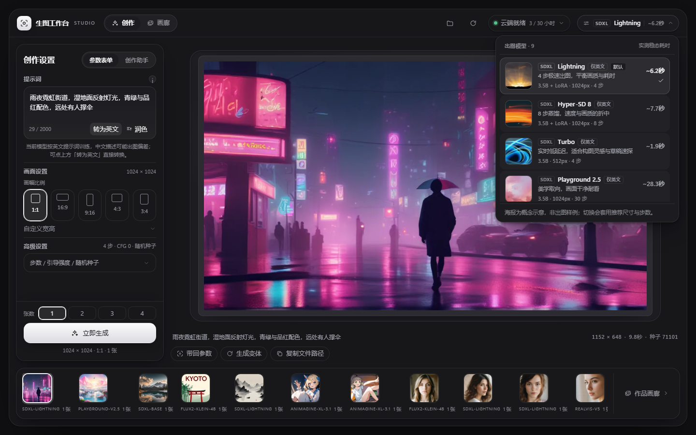

<div align="center">

# Image Studio (dsh-our-imagen)

**An open-source text-to-image workbench and visual agent plugin for DeepSeek Harness.**<br/>
Runs on Kaggle's free dual-GPU quota (30 hrs/week) by default, with zero local VRAM usage and all generated images saved directly to disk.

[](#)
[](https://github.com/deepseek-ai/DeepSeek-Harness)
[](LICENSE)
[](https://github.com/nanxfu/dsh-our-imagen)

> **Preview Release**: Kaggle's free dual-GPU driver is built in by default. The Google Colab driver is available (large-VRAM models are Colab-only), while local GPUs and self-hosted workers are still planned.

[Quick Start](#quick-start) · [Backends](#backend-drivers) · [Features](#features) · [Model Showcase](#model-showcase) · [FAQ](#faq) · [Development](#development--testing) · [中文](README.md)

</div>

---

## Overview

**Image Studio** (`dsh-our-imagen`) is an image generation plugin for [DeepSeek Harness (DSH)](https://github.com/deepseek-ai/DeepSeek-Harness).

Not every machine has a high-VRAM GPU, and setting up PyTorch, CUDA, and ComfyUI locally takes effort. This plugin separates the **UI** from the **compute backend**: you run a lightweight local workbench, offload inference to free cloud GPUs, and save results directly to `imagen-output/` in your local workspace.

---

## Backend Drivers

| Driver | Status | Compute | Cost | Notes |
| :--- | :---: | :--- | :--- | :--- |
| **Kaggle GPU Driver** | **Built-in (Default)** | 2×Nvidia Tesla T4 (30 GB VRAM) | **Free** (30 hrs/week quota) | Ready out of the box with auto session management and encrypted transfer |
| **Google Colab Driver** | **Available** | Nvidia T4 (free) / L4, A100 (Colab Pro) | Free / Subscription | Notebook mount with direct tunnel; `Z-Image Turbo`, `Qwen-Image 2.1`, and `FLUX.2 Klein 9B` need more VRAM and are Colab-only |
| **Self-hosted Worker** | **Planned** | Private server / AutoDL / RunPod | Pay-as-you-go / Self-hosted | For private GPUs or always-on setups |
| **Local (Local/ComfyUI)** | **Planned** | Local GPU (RTX 3060/4090, etc.) | Local hardware | For offline, low-latency local inference |

**Switching to Colab**: open Runtime Settings → set the compute source to `Colab Pro (authorization required)` → under **Google / Colab authorization** click **Authorize in browser**; credentials are saved to `%USERPROFILE%\.imagen\colab-credentials.json`. GPU tiers include T4 / L4 / A100 plus high-memory machines. `Z-Image Turbo`, `Qwen-Image 2.1`, and `FLUX.2 Klein 9B` require the Colab source before they can be selected in the model picker.

---

## Features

### 1. Standalone Workbench

* **7 Models & Dual Compute**: Includes 7 modern open-source models (see [FAQ](#faq) and [`models/*.json`](models/)). Four run on both Kaggle's free T4 quota and Colab, while `Z-Image Turbo`, `Qwen-Image 2.1`, and `FLUX.2 Klein 9B` require Colab for higher VRAM.
* **Adaptive Parameter Panel**: Prompt, aspect ratio, resolution, steps, CFG scale, and batch count in one focused panel—only showing parameters and reference inputs supported by the active model, with one-click English translation and quick modifiers.
* **In-Place Stage Tools**: Select any work to run local paint, full repaint, ×2 upscale (Real-ESRGAN), or outpaint right on the stage, automatically archived as child versions.
* **Version Tree & Gallery**: The bottom filmstrip folds by derivation tree and preserves unsubmitted drafts per work; the gallery groups by date with search, favorites, and batch management.

<div align="center">
  
  <p><sub>Standalone workbench: parameter panel, live canvas, and recent filmstrip</sub></p>
</div>

### 2. Chat Integration & Assistant

* **Direct Tool Calls**: Registers `imagen_generate`, `imagen_batch`, `imagen_recipes`, `imagen_session`, `imagen_history`, and `imagen_cancel`, so you can generate images directly from chat. `imagen_batch` plans a whole set of images in one call, and `imagen_recipes` only returns visible prompt templates — no hidden style suffixes.
* **Confirm Before Running**: Translates natural-language requests into English prompts, infers aspect ratios, checks model constraints, and shows a confirmation card before starting inference.
* **Model Awareness**: Understands prompt conventions and strengths across all 7 models and suggests a better match when appropriate.
* **Workbench Sync**: Load confirmation cards into the workbench for fine-tuning, or open chat-generated images in the workbench for further editing.

<div align="center">
  
  <p><sub>Chat card: confirm parameters first, then generate directly to local disk</sub></p>
</div>

### 3. Local Storage & Session Management

* **Local-Only Storage**: Generated images stream back over a per-session Bearer Token tunnel and are written directly to `imagen-output/`, without third-party image hosts.
* **Idle Auto-Shutdown**: The remote kernel shuts down automatically after 30 minutes of inactivity (configurable), or anytime from the top-right controls.
* **Session Recovery**: `.imagen/session.json` tracks the active session so DSH restarts or page refreshes reconnect to the existing instance instead of starting a duplicate one.

```text
[ DSH Workbench / Chat ]
          │  /imagen-api/* (local)
          ▼
[ Local Plugin Host (Node.js) ] ── (write) ──▶ [ Local imagen-output/ ]
          │  kaggle kernels push
          ▼
[ Kaggle Cloud (2×Tesla T4) ]
   daemon.py (diffusers)
          │  One-time Bearer Token tunnel
          └─────────────────────────────────▶ (streamed back locally)
```

---

## Screenshots

<table>
<tr>
<td width="50%">

<div align="center">
  
  <p><sub>Dark theme model picker: built-in models with measured generation times</sub></p>
</div>

</td>
<td width="50%">

<div align="center">
  
  <p><sub>Gallery: grouped by date, with search, favorites, batch selection, and single-image deletion</sub></p>
</div>

</td>
</tr>
</table>

---

## Model Showcase

All 7 samples below were generated by this plugin on real GPUs and converted to WebP without post-processing. Each sample highlights its model's specialty (street photography, ink wash, bilingual typography, still-life lighting, and anime illustration); `Z-Image Turbo` and `Qwen-Image 2.1` were warmed up at matching resolution so timings reflect steady-state generation:

<table>
<tr>
<td width="50%">
<div align="center">
  
  <p><sub>SDXL Lightning · Rainy Neon Street · Kaggle 2×T4 · ~9.8s</sub></p>
</div>
</td>
<td width="50%">
<div align="center">
  
  <p><sub>FLUX.2 Klein 4B · Minimalist Kyoto Poster · Kaggle 2×T4 · ~6.8s</sub></p>
</div>
</td>
</tr>
<tr>
<td width="50%">
<div align="center">
  
  <p><sub>FLUX.2 Klein 9B · Clockmaker Workbench · Colab L4 · 113.1s</sub></p>
</div>
</td>
<td width="50%">
<div align="center">
  
  <p><sub>SANA-Sprint 1.6B · Crane in a Lotus Pond · Colab L4 · 4.07s</sub></p>
</div>
</td>
</tr>
</table>

<table>
<tr>
<td width="33.3%">
<div align="center">
  
  <p><sub>Z-Image Turbo · Rainy Alley Bookstore · Colab L4 · 29.19s</sub></p>
</div>
</td>
<td width="33.3%">
<div align="center">
  
  <p><sub>Qwen-Image 2.1 · Botanica Conservatory Poster · Colab L4 · 39.25s</sub></p>
</div>
</td>
<td width="33.3%">
<div align="center">
  
  <p><sub>Anima Turbo v1.1 · Girl at Seaside Station · Colab L4 · 9.81s</sub></p>
</div>
</td>
</tr>
</table>

---

## Quick Start

### Step 1: Set Up Kaggle Credentials

> Note: Your Kaggle account must have **Phone Verification** completed in account settings to receive free GPU quota; unverified accounts fall back to CPU.

**Option 1: Browser OAuth without installing `kaggle` CLI**
Open the workbench → top bar **GPU Status** → **Runtime Settings** → **Advanced** → set **Kaggle Access Mode** to **Direct**, then click **Sign in with Kaggle in Browser** to complete OAuth (credentials are saved to `%USERPROFILE%\.kaggle\credentials.json`). You can also run `node tools/kaggle-login.mjs`.

**Option 2: `kaggle` CLI 2.x**
```powershell
pip install -U kaggle
kaggle auth login
```
This opens a browser for OAuth and writes credentials to `%USERPROFILE%\.kaggle\credentials.json`.

**Option 3: Manual API Token (legacy CLI)**
1. Go to [Kaggle API Settings](https://www.kaggle.com/settings/api) and click **Create New Token**.
2. Save the token locally:
   * **Windows (PowerShell)**:
     ```powershell
     New-Item -ItemType Directory -Force "$env:USERPROFILE\.kaggle" | Out-Null
     Set-Content -NoNewline "$env:USERPROFILE\.kaggle\access_token" "YOUR_KAGGLE_TOKEN"
     ```
   * **macOS / Linux (Bash / Zsh)**:
     ```bash
     mkdir -p ~/.kaggle
     printf '%s' 'YOUR_KAGGLE_TOKEN' > ~/.kaggle/access_token
     chmod 600 ~/.kaggle/access_token
     ```

Verify with `kaggle quota` to confirm GPU/TPU quota is visible.

---

### Step 2: Install the Plugin in DSH

Replace `web` with your DSH profile name (`desktop` for DSH Desktop):

* **Option A (Recommended): Install via npm**
  ```bash
  dsh plugin --profile web add dsh-our-imagen
  ```
  To upgrade: run `dsh plugin --profile web remove dsh-our-imagen`, reinstall, and restart DSH. You can also search `dsh-our-imagen` in the **1024 Plugin Market (deepseek1024.com)**.

* **Option B: Install from GitHub or UI**
  ```bash
  dsh plugin --profile web add github:nanxfu/dsh-our-imagen
  ```
  Or in DSH: **Settings** → **Plugins** → **Install Plugin**, paste `dsh-our-imagen` or `github:nanxfu/dsh-our-imagen`, then restart DSH.

* **Option C: Release tarball** (useful if GitHub raw access is unstable)
  ```bash
  dsh plugin --profile web add https://github.com/nanxfu/dsh-our-imagen/releases/download/v0.14.0/dsh-our-imagen-0.14.0.tgz
  ```

* **Option D: Offline zip + Load Bundle**
  1. Download `dsh-our-imagen-<version>.zip` from [Releases](https://github.com/nanxfu/dsh-our-imagen/releases) and extract it;
  2. In DSH: **Settings** → **Plugins** → **Load Bundle**, select the extracted folder;
  3. Click the **Image Studio** icon in the left sidebar.

* **Option E: Local source link (development)**
  ```bash
  dsh plugin --profile desktop add D:\path\to\dsh-our-imagen
  ```

---

### Step 3: Start the Cloud Kernel

1. Open the workbench and click **Start / Wake Cloud** in the top bar;
2. First-time startup takes ~3–10 minutes for Kaggle to allocate resources and load weights;
3. Once status turns `Online`, you can generate images in seconds.

---

## FAQ

<details>
<summary><b>Q1: Does it cost anything? Is 30 hours/week enough?</b></summary>

It is free. The plugin is MIT-licensed, and compute uses Kaggle's free weekly **30-hour GPU quota (2×Nvidia T4)** for phone-verified accounts, which is plenty for regular personal use.
</details>

<details>
<summary><b>Q2: Do I need a dedicated GPU on my computer?</b></summary>

No. Model loading and inference run on cloud GPUs (Kaggle or Colab); your local machine only renders the UI and saves the output files.
</details>

<details>
<summary><b>Q3: Why does the first startup take a few minutes?</b></summary>

Cold start includes allocating a cloud instance (Kaggle 2×T4, or Colab L4 / A100), checking the runtime environment, and downloading/loading model weights, which typically takes 3–10 minutes. Once ready, subsequent generations take seconds. The kernel auto-shuts down after 30 minutes of idle time, or you can shut it down manually anytime.
</details>

<details>
<summary><b>Q4: Are my images uploaded to third-party image hosts?</b></summary>

No. Generated images stream back over a per-session temporary Bearer Token tunnel and are saved directly to `imagen-output/` in your local workspace.
</details>

<details>
<summary><b>Q5: Which models are included?</b></summary>

Model configs live in [`models/*.json`](models/). There are 7 presets today:

| Model | Positioning | Compute source | License |
| :--- | :--- | :--- | :--- |
| `SDXL Lightning` | Default; SDXL + 4-step LoRA, fast generation, img2img / inpaint | Kaggle / Colab | OpenRAIL++ |
| `SANA-Sprint 1.6B` | 1.6B Linear DiT, 2-step ultra-fast 1024px generation | Kaggle / Colab | Apache-2.0 |
| `Z-Image Turbo` | 6B S3-DiT, photorealism, bilingual text and inpainting | Colab only | Apache-2.0 |
| `Qwen-Image 2.1` | 7B DiT + Qwen3-VL, strong typography and multi-image reference editing; RGBA reference input | Colab only | Qwen Research License (non-commercial) |
| `FLUX.2 Klein 4B` | Lightweight next-gen architecture, multi-image reference + outpaint engine (Outpaint LoRA) | Kaggle / Colab | Apache-2.0 |
| `FLUX.2 Klein 9B` | 9B distilled editing model, 4-step generation, reference editing | Colab only (HF gated) | FLUX Non-Commercial |
| `Anima Turbo v1.1` | 2B anime DiT, natural language and Danbooru tags | Kaggle / Colab | CircleStone Labs non-commercial |

Retired presets: `SDXL Turbo`, `Hyper-SDXL 8-Step`, `SDXL Base 1.0`, `Playground v2.5`, `RealVisXL V5.0`, `Animagine XL 3.1`, `SDXL Inpaint`, `Anima Light Lavender`.
</details>

---

## Development & Testing

| Task | Command | Notes |
| :--- | :--- | :--- |
| **Install dependencies** | `npm install` | Install dev and packaging dependencies |
| **Run all tests** | `npm test` | Build client and run contract, host, client, and Python remote tests |
| **Contract tests** | `npm run test:contract` | Validate model configs and API contracts |
| **Offline mock** | `node test/mock-daemon.mjs` | Simulate remote communication locally without Kaggle |
| **Build client** | `node build.mjs` | Bundle frontend into `client.js` |
| **Preview & screenshots** | `node tools/preview.mjs --shot` | Generate preview pages (`--readme` also refreshes README screenshots) |
| **Package release** | `npm run package` | Build standalone plugin bundle in `dist/` |

---

## Author

Follow on Douyin: **Lumen流明** (`42906749348`):

<div align="center">
  
</div>

---

## License & Acknowledgments

- Licensed under the [MIT License](LICENSE).
- Thanks to the [DeepSeek Harness (DSH)](https://github.com/deepseek-ai/DeepSeek-Harness) team for the plugin architecture and design system.
- Thanks to Kaggle for providing free GPU compute.
- Thanks to Hugging Face diffusers and the open-source model teams (Stability AI, ByteDance, Efficient-Large-Model, Tongyi-MAI, Black Forest Labs, CircleStone Labs, etc.).
