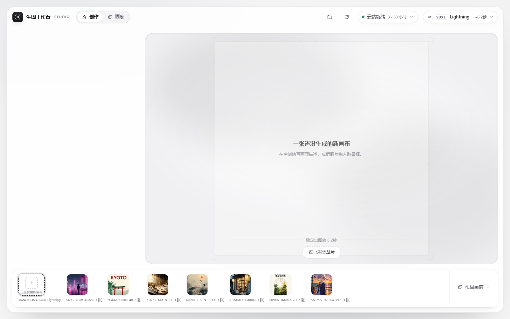
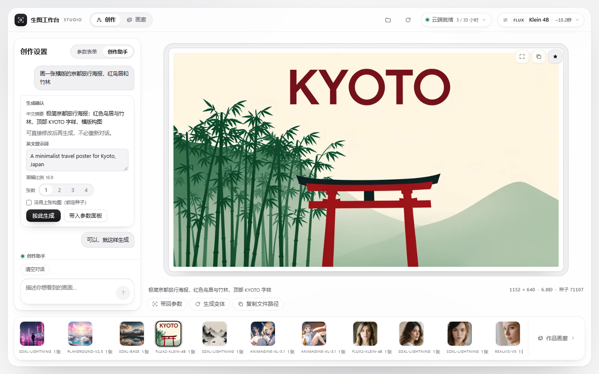
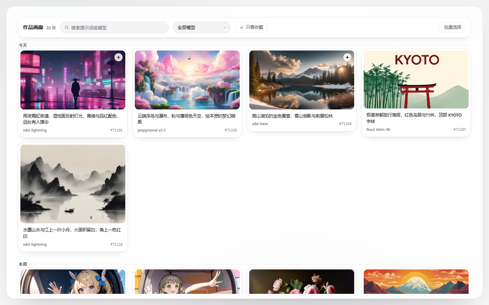
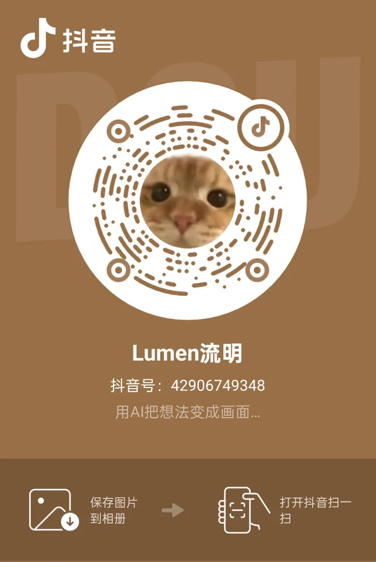

<div align="center">

# Image Studio (dsh-our-imagen)

**An open-source text-to-image workbench and visual agent plugin for DeepSeek Harness.**<br/>
Runs on Kaggle's free dual-GPU quota (30 hrs/week) by default, with zero local VRAM usage and all generated images saved directly to disk.

[](#)
[](https://github.com/deepseek-ai/DeepSeek-Harness)
[](LICENSE)
[](https://github.com/nanxfu/dsh-our-imagen)

> **Preview Release**: Kaggle's free dual-GPU driver is built in by default. Support for Google Colab, local GPUs, and self-hosted workers is in progress.

[Quick Start](#quick-start) · [Backends](#backend-drivers) · [Features](#features) · [FAQ](#faq) · [Development](#development--testing) · [中文](README.md)

</div>

---

## Overview

**Image Studio** (`dsh-our-imagen`) is an image generation plugin for [DeepSeek Harness (DSH)](https://github.com/deepseek-ai/DeepSeek-Harness).

Not every machine has a high-VRAM GPU, and setting up PyTorch, CUDA, and ComfyUI locally takes effort. This plugin separates the **UI** from the **compute backend**: you run a lightweight local workbench, offload inference to free cloud GPUs, and save results directly to `imagen-output/` in your local workspace.

---

## Backend Drivers

| Driver | Status | Compute | Cost | Notes |
| :--- | :---: | :--- | :--- | :--- |
| **Kaggle GPU Driver** | **Built-in (Default)** | 2×Nvidia Tesla T4 (30 GB VRAM) | **Free** (30 hrs/week quota) | Ready out of the box with auto session management and encrypted transfer |
| **Google Colab Driver** | **In Progress** | Nvidia T4 / A100 | Free / Subscription | Notebook mount with direct tunnel |
| **Self-hosted Worker** | **Planned** | Private server / AutoDL / RunPod | Pay-as-you-go / Self-hosted | For private GPUs or always-on setups |
| **Local (Local/ComfyUI)** | **Planned** | Local GPU (RTX 3060/4090, etc.) | Local hardware | For offline, low-latency local inference |

---

## Features

<table>
<tr>
<td width="48%">

### 1. Standalone Workbench
* **9 Built-in Models**: Fast models (`SDXL Lightning`, `Hyper-SDXL`, `SDXL Turbo`), general/photorealistic (`SDXL Base`, `RealVisXL`, `Playground v2.5`), anime (`Animagine XL 3.1`, `Anima Light Lavender`), and `FLUX.2 Klein 4B`.
* **Focused Controls**: Prompt, aspect ratio, resolution, steps, CFG scale, and seed in one panel, with batch count (1–4) pinned in the footer.
* **Effective Parameters Only**: Unused fields (such as negative prompts on 4-step models or `FLUX.2 Klein 4B`) are hidden and omitted from requests. When a reference image is attached, output dimensions follow the reference image.
* **Quick Modifiers**: Collapsible one-click English tags for lighting, material, composition, and mood (with localized UI labels).
* **Image-to-Image**: Send any gallery image back as a reference with a denoising strength slider for iterative edits (SDXL family).
* **Filmstrip & Gallery**: Review recent outputs in the bottom filmstrip, restore all parameters or generate variations in one click, and manage your date-grouped gallery with search, favorites, batch selection, and single-image deletion.

</td>
<td width="52%">

<div align="center">
  
  <p><sub>Standalone workbench: parameter panel, live canvas, and recent filmstrip</sub></p>
</div>

</td>
</tr>

<tr>
<td width="48%">

### 2. Chat Integration & Assistant
* **Direct Tool Calls**: Registers `imagen_generate`, `imagen_session`, and `imagen_history` so you can generate images directly from chat.
* **Confirm Before Running**: Translates natural-language requests into English prompts, infers aspect ratios, checks model constraints, and shows a confirmation card before starting inference.
* **Model Awareness**: Understands prompt conventions and strengths across all 9 models and suggests a better match when appropriate.
* **Workbench Sync**: Load confirmation cards into the workbench for fine-tuning, or open chat-generated images in the workbench for further editing.

</td>
<td width="52%">

<div align="center">
  
  <p><sub>Chat card: confirm parameters first, then generate directly to local disk</sub></p>
</div>

</td>
</tr>

<tr>
<td width="48%">

### 3. Local Storage & Session Management
* **Local-Only Storage**: Generated images stream back over a per-session Bearer Token tunnel and are written directly to `imagen-output/`, without third-party image hosts.
* **Idle Auto-Shutdown**: The remote kernel shuts down automatically after 30 minutes of inactivity (configurable), or anytime from the top-right controls.
* **Session Recovery**: `.imagen/session.json` tracks the active session so DSH restarts or page refreshes reconnect to the existing instance instead of starting a duplicate one.

</td>
<td width="52%">

```text
[ DSH Workbench / Chat ]
          │  /imagen-api/* (local)
          ▼
[ Local Plugin Host (Node.js) ] ── (write) ──▶ [ Local imagen-output/ ]
          │  kaggle kernels push
          ▼
[ Kaggle Cloud (2×Tesla T4) ]
   daemon.py (diffusers)
          │  One-time Bearer Token tunnel
          └─────────────────────────────────▶ (streamed back locally)
```

</td>
</tr>
</table>

---

## Screenshots

<table>
<tr>
<td width="50%">

<div align="center">
  
  <p><sub>Dark theme model picker: 9 built-in models with measured generation times</sub></p>
</div>

</td>
<td width="50%">

<div align="center">
  
  <p><sub>Gallery: grouped by date, with search, favorites, batch selection, and single-image deletion</sub></p>
</div>

</td>
</tr>
</table>

---

## Model Showcase

All 9 samples below were generated on Kaggle 2×T4 using this plugin and converted to WebP without post-processing.

<table>
<tr>
<td width="33.3%">
<div align="center">
  
  <p><sub>SDXL Lightning · Rainy Neon Street · ~9.8s</sub></p>
</div>
</td>
<td width="33.3%">
<div align="center">
  
  <p><sub>Hyper-SDXL 8-Step · Baroque Still Life · ~8.0s</sub></p>
</div>
</td>
<td width="33.3%">
<div align="center">
  
  <p><sub>SDXL Turbo · Samurai Under Crimson Moon · ~3.9s</sub></p>
</div>
</td>
</tr>

<tr>
<td width="33.3%">
<div align="center">
  
  <p><sub>Playground v2.5 · Floating Islands · ~19.6s</sub></p>
</div>
</td>
<td width="33.3%">
<div align="center">
  
  <p><sub>SDXL Base 1.0 · Alpine Lake at Dusk · ~17.1s</sub></p>
</div>
</td>
<td width="33.3%">
<div align="center">
  
  <p><sub>RealVisXL V5.0 · Fisherman Portrait · ~21.1s</sub></p>
</div>
</td>
</tr>

<tr>
<td width="33.3%">
<div align="center">
  
  <p><sub>FLUX.2 Klein 4B · Minimalist Kyoto Poster · ~6.8s</sub></p>
</div>
</td>
<td width="33.3%">
<div align="center">
  
  <p><sub>Animagine XL 3.1 · Girl in Sakura Alley · ~21.1s</sub></p>
</div>
</td>
<td width="33.3%">
<div align="center">
  
  <p><sub>Anima Light Lavender · Lavender Field at Dusk · ~63.4s</sub></p>
</div>
</td>
</tr>
</table>

---

## Quick Start

### Step 1: Set Up Kaggle Credentials

> Note: Your Kaggle account must have **Phone Verification** completed in account settings to receive free GPU quota; unverified accounts fall back to CPU.

**Option 1: Browser OAuth without installing `kaggle` CLI**
Open the workbench → top bar **GPU Status** → **Runtime Settings** → **Advanced** → set **Kaggle Access Mode** to **Direct**, then click **Sign in with Kaggle in Browser** to complete OAuth (credentials are saved to `%USERPROFILE%\.kaggle\credentials.json`). You can also run `node tools/kaggle-login.mjs`.

**Option 2: `kaggle` CLI 2.x**
```powershell
pip install -U kaggle
kaggle auth login
```
This opens a browser for OAuth and writes credentials to `%USERPROFILE%\.kaggle\credentials.json`.

**Option 3: Manual API Token (legacy CLI)**
1. Go to [Kaggle API Settings](https://www.kaggle.com/settings/api) and click **Create New Token**.
2. Save the token locally:
   * **Windows (PowerShell)**:
     ```powershell
     New-Item -ItemType Directory -Force "$env:USERPROFILE\.kaggle" | Out-Null
     Set-Content -NoNewline "$env:USERPROFILE\.kaggle\access_token" "YOUR_KAGGLE_TOKEN"
     ```
   * **macOS / Linux (Bash / Zsh)**:
     ```bash
     mkdir -p ~/.kaggle
     printf '%s' 'YOUR_KAGGLE_TOKEN' > ~/.kaggle/access_token
     chmod 600 ~/.kaggle/access_token
     ```

Verify with `kaggle quota` to confirm GPU/TPU quota is visible.

---

### Step 2: Install the Plugin in DSH

Replace `web` with your DSH profile name (`desktop` for DSH Desktop):

* **Option A (Recommended): Install via npm**
  ```bash
  dsh plugin --profile web add dsh-our-imagen
  ```
  To upgrade: run `dsh plugin --profile web remove dsh-our-imagen`, reinstall, and restart DSH. You can also search `dsh-our-imagen` in the **1024 Plugin Market (deepseek1024.com)**.

* **Option B: Install from GitHub or UI**
  ```bash
  dsh plugin --profile web add github:nanxfu/dsh-our-imagen
  ```
  Or in DSH: **Settings** → **Plugins** → **Install Plugin**, paste `dsh-our-imagen` or `github:nanxfu/dsh-our-imagen`, then restart DSH.

* **Option C: Release tarball** (useful if GitHub raw access is unstable)
  ```bash
  dsh plugin --profile web add https://github.com/nanxfu/dsh-our-imagen/releases/download/v0.11.0/dsh-our-imagen-0.11.0.tgz
  ```

* **Option D: Offline zip + Load Bundle**
  1. Download `dsh-our-imagen-<version>.zip` from [Releases](https://github.com/nanxfu/dsh-our-imagen/releases) and extract it;
  2. In DSH: **Settings** → **Plugins** → **Load Bundle**, select the extracted folder;
  3. Click the **Image Studio** icon in the left sidebar.

* **Option E: Local source link (development)**
  ```bash
  dsh plugin --profile desktop add D:\path\to\dsh-our-imagen
  ```

---

### Step 3: Start the Cloud Kernel

1. Open the workbench and click **Start / Wake Cloud** in the top bar;
2. First-time startup takes ~3–10 minutes for Kaggle to allocate resources and load weights;
3. Once status turns `Online`, you can generate images in seconds.

---

## FAQ

<details>
<summary><b>Q1: Does it cost anything? Is 30 hours/week enough?</b></summary>

It is free. The plugin is MIT-licensed, and compute uses Kaggle's free weekly **30-hour GPU quota (2×Nvidia T4)** for phone-verified accounts, which is plenty for regular personal use.
</details>

<details>
<summary><b>Q2: Do I need a dedicated GPU on my computer?</b></summary>

No. Model loading and inference run on Kaggle's cloud GPUs; your local machine only renders the UI and saves the output files.
</details>

<details>
<summary><b>Q3: Why does the first startup take a few minutes?</b></summary>

Cold start includes allocating the 2×T4 instance, checking the runtime environment, and downloading/loading model weights, which typically takes 3–10 minutes. Once ready, subsequent generations take seconds. The kernel auto-shuts down after 30 minutes of idle time, or you can shut it down manually anytime.
</details>

<details>
<summary><b>Q4: Are my images uploaded to third-party image hosts?</b></summary>

No. Generated images stream back over a per-session temporary Bearer Token tunnel and are saved directly to `imagen-output/` in your local workspace.
</details>

<details>
<summary><b>Q5: Which models are included?</b></summary>

Model configs live in [`models/*.json`](models/):
- `SDXL Lightning` (default, 4-step fast)
- `Hyper-SDXL 8-Step` (balanced speed & detail)
- `SDXL Turbo` (ultra-fast drafts)
- `Playground v2.5` (rich colors & aesthetics)
- `SDXL Base 1.0` (standard SDXL base)
- `RealVisXL V5.0` (photorealistic portraits)
- `FLUX.2 Klein 4B` (lightweight next-gen architecture)
- `Animagine XL 3.1` (anime)
- `Anima Light Lavender` (anime illustration, Cosmos-Predict2 2B base)
</details>

---

## Development & Testing

| Task | Command | Notes |
| :--- | :--- | :--- |
| **Install dependencies** | `npm install` | Install dev and packaging dependencies |
| **Run all tests** | `npm test` | Build client and run contract, host, client, and Python remote tests |
| **Contract tests** | `npm run test:contract` | Validate model configs and API contracts |
| **Offline mock** | `node test/mock-daemon.mjs` | Simulate remote communication locally without Kaggle |
| **Build client** | `node build.mjs` | Bundle frontend into `client.js` |
| **Preview & screenshots** | `node tools/preview.mjs --shot` | Generate preview pages (`--readme` also refreshes README screenshots) |
| **Package release** | `npm run package` | Build standalone plugin bundle in `dist/` |

---

## Author

Follow on Douyin: **Lumen流明** (`42906749348`):

<div align="center">
  
</div>

---

## License & Acknowledgments

- Licensed under the [MIT License](LICENSE).
- Thanks to the [DeepSeek Harness (DSH)](https://github.com/deepseek-ai/DeepSeek-Harness) team for the plugin architecture and design system.
- Thanks to Kaggle for providing free GPU compute.
- Thanks to Hugging Face diffusers and the open-source model teams (Stability AI, ByteDance, Playground AI, CagliostroLab, etc.).
