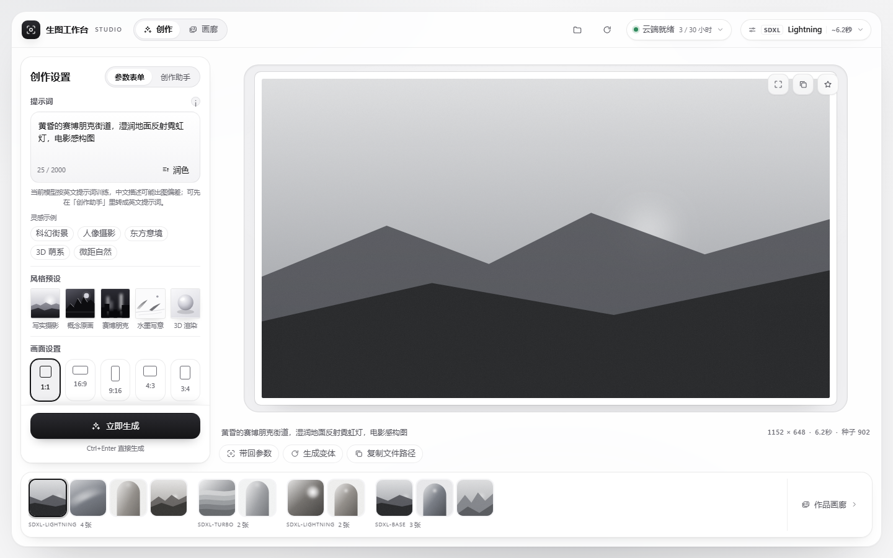
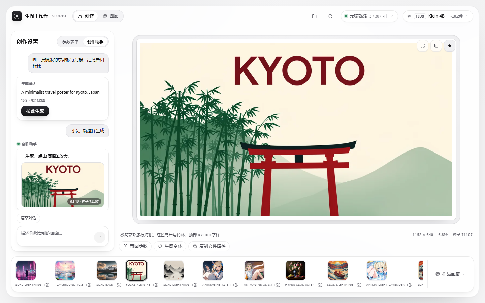
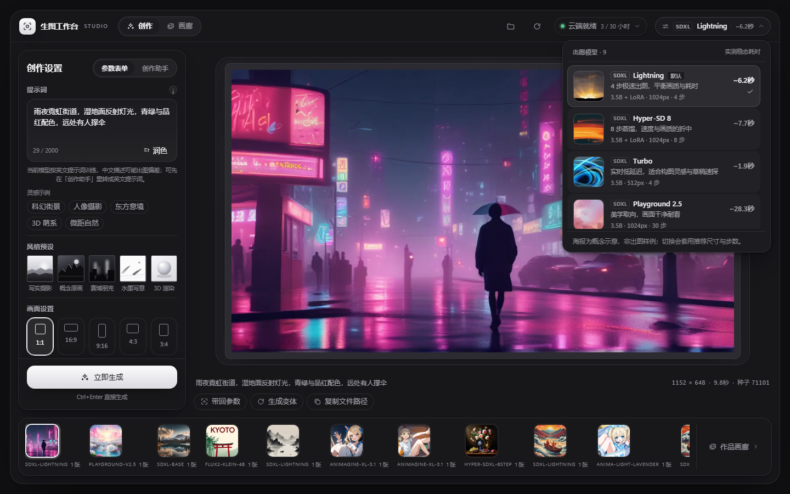
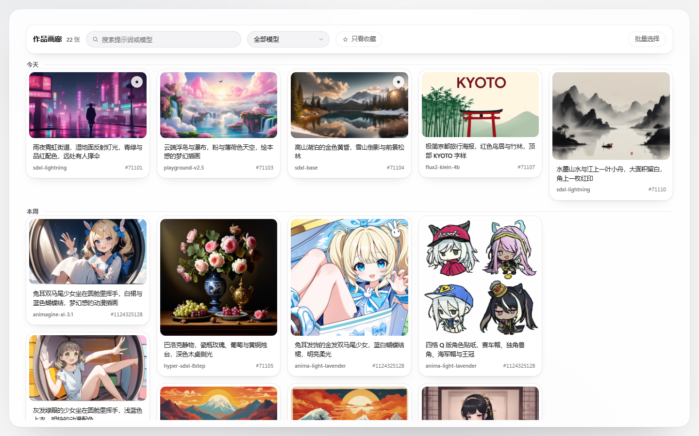
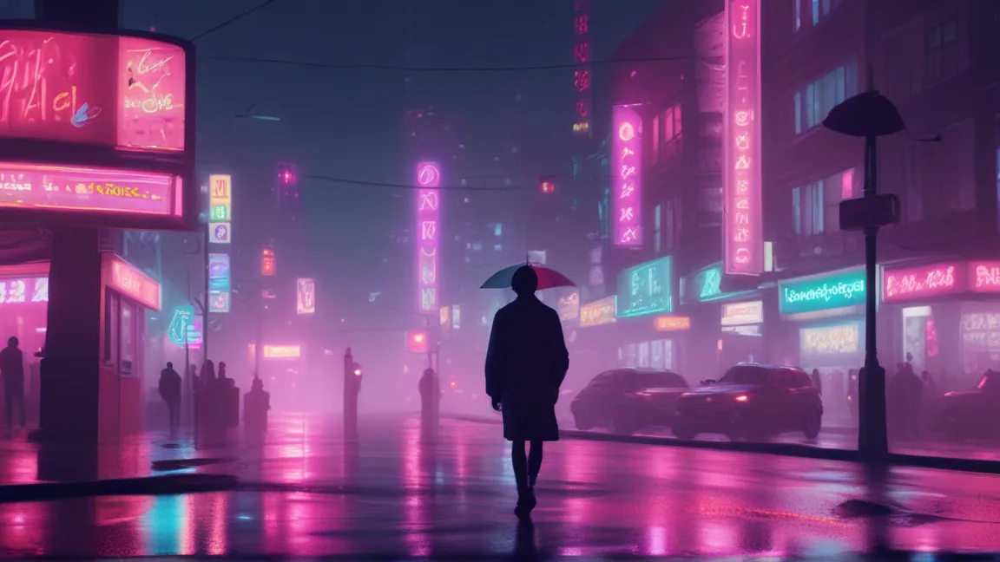
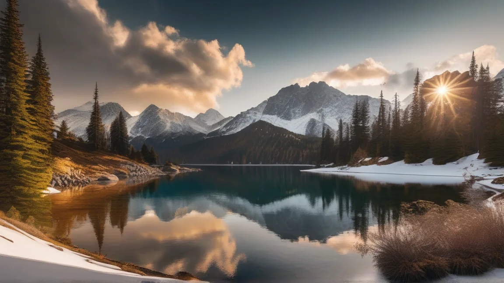
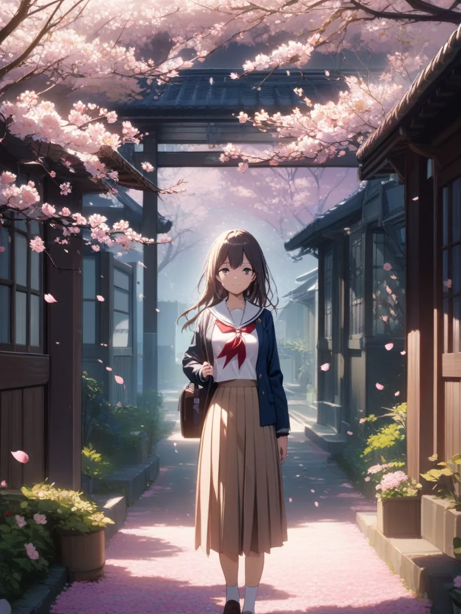
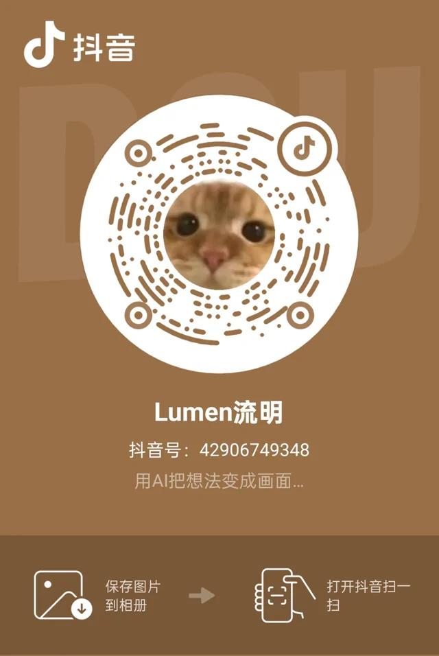

<div align="center">

# Imagen Studio (dsh-our-imagen)

**Open-source text-to-image studio & agent visual tool for DeepSeek Harness.**<br/>
Out-of-the-box support for Kaggle free 2×T4 cloud GPUs (30 hrs/week). No local GPU needed, continuous generations, 100% saved locally.

[](#)
[](https://github.com/deepseek-ai/DeepSeek-Harness)
[](LICENSE)
[](https://github.com/nanxfu/dsh-our-imagen)

> 🚧 **Early Preview**: Designed with pluggable backend drivers. Ships with Kaggle 2×T4 free GPU as the default driver; Google Colab, local GPU, and self-hosted worker drivers are actively being integrated. More stable releases and cutting-edge models are on the way!

[Quick Start](#-quick-start-in-3-steps) · [What is it](#-what-is-it) · [Backends](#-backend-drivers) · [FAQ](#-faq) · [Development](#-development--testing) · [简体中文](README.md)

</div>

---

## 💡 What is it

**Imagen Studio** (repo: `dsh-our-imagen`) is an open-source image generation studio & visual agent plugin built for [DeepSeek Harness (DSH)](https://github.com/deepseek-ai/DeepSeek-Harness).

It solves a very practical problem: many creators and developers want to use modern open-source text-to-image models, but lack a machine with high VRAM, or don't want to maintain a hefty multi-gigabyte local environment (PyTorch, CUDA, ComfyUI, etc.).

Built with a **decoupled, pluggable backend architecture**:
1. **You get a full-page visual studio**: wake up cloud GPUs with one click, select a curated model, type your prompt, and generate.
2. **You get out-of-the-box chat agent tools**: ask your assistant in chat "generate a cyberpunk rain street", and the agent reviews the intent, shows a confirmation card, and invokes the generation.
3. **Zero-cost computing out of the box**: ships with a default Kaggle 2×T4 driver (30 hrs/week free quota), with Google Colab and custom worker integrations coming soon.
4. **No quota waste or third-party image hosting**: auto-shuts down after 30 minutes of inactivity, and generated images are streamed directly into your local `imagen-output/` workspace folder over an encrypted one-time tunnel.

---

## 🔌 Backend Drivers

Imagen Studio decouples the visual user experience from the underlying diffusion inference engine:

| Backend Driver | Status | Hardware Tier | Cost / Barrier | Note |
| :--- | :---: | :--- | :--- | :--- |
| **Kaggle GPU Driver** | **Built-in (Default)** | 2×Nvidia Tesla T4 (30G VRAM) | **100% Free** (30 hrs/wk) | Default out-of-the-box driver, zero local GPU requirements, encrypted peer rendezvous |
| **Google Colab Driver** | **In Progress** | Nvidia T4 / A100 | **Free / Pro** | One-click notebook attach & tunnel link, expanding free compute sources |
| **Custom Remote Worker** | **Planned** | Self-hosted / AutoDL / RunPod | Pay-per-use / Private | Ideal for creators with existing private GPU servers or 24/7 needs |
| **Local Direct (ComfyUI)** | **Planned** | Local Dedicated GPU (RTX 3060/4090) | Own Hardware | Ideal for users with local high-VRAM hardware seeking zero latency and offline usage |

---

## 🎨 Key Features

<table>
<tr>
<td width="48%">

### 1. Dedicated Full-Page Studio
* **Curated Open-Source Models**: From ultra-fast `SDXL Lightning` and `Hyper-SDXL`, to cinematic `SDXL Base` and `RealVisXL`, anime-tailored `Animagine XL 3.1` / `Anima`, and cutting-edge `FLUX.2 Klein 4B`.
* **Single-Track Creative Rail**: Prompt, negative prompt, aspect ratio (1:1, 16:9, 9:16, 4:3, 3:4), step count, and seed all in one clear view.
* **4-Dimension Prompt Polish**: Non-destructive quick additions for Lighting, Material, Composition, and Mood — English fragments go into the prompt while the UI shows localized labels.
* **Bottom Filmstrip & History Drawer**: Review recent generations instantly, with one-click actions to bring back parameters or generate variants.

</td>
<td width="52%">

<div align="center">
  
  <p><sub>Dedicated full-page studio: parameters, live canvas, and recent filmstrip</sub></p>
</div>

</td>
</tr>

<tr>
<td width="48%">

### 2. Creation Assistant & Chat Tools
* **In-Chat Generation**: The host automatically registers `imagen_generate`, `imagen_session`, and `imagen_history` agent tools.
* **Natural Language Intent Alignment**: Describe your idea casually; the built-in assistant refines it into standard English prompts, suggests appropriate aspect ratios, and **presents a clear confirmation card before executing**.
* **Seamless Bi-Directional Flow**: Images created in chat can be expanded from the right-hand filmstrip and opened in the full studio for further editing.

</td>
<td width="52%">

<div align="center">
  
  <p><sub>Chat integration: review card first, confirm to run, saved locally</sub></p>
</div>

</td>
</tr>

<tr>
<td width="48%">

### 3. Local Storage & Auto Quota Saver
* **100% Saved Locally**: Images are transferred via a one-time Bearer token tunnel straight into your workspace's `imagen-output/` directory, without touching any third-party public image hosts.
* **Anti-Waste Auto Shutdown**: The remote Kaggle kernel shuts down automatically after 30 minutes of idle time (configurable), or can be shut down manually at any time.
* **Disaster Recovery**: Session states are atomically recorded in `.imagen/session.json`. If DSH restarts or reloads, the plugin checks instance liveness and re-attaches seamlessly.

</td>
<td width="52%">

```text
[ DSH Studio / Chat Window ]
          │  /imagen-api/* (Local IPC)
          ▼
[ Local Host (Node.js) ] ── (Save) ──▶ [ Local imagen-output/ ]
          │  kaggle kernels push
          ▼
[ Kaggle Cloud (2×Tesla T4) ]
   daemon.py (diffusers)
          │  Single-use Bearer Token Tunnel
          └─────────────────────────────▶ (Secure Local Stream)
```

</td>
</tr>
</table>

---

## 🖼 More Screens

<table>
<tr>
<td width="50%">

<div align="center">
  
  <p><sub>Dark-theme model picker: nine built-in models compared, with measured generation time</sub></p>
</div>

</td>
<td width="50%">

<div align="center">
  
  <p><sub>Gallery: grouped by date, with search, favorites, and batch selection</sub></p>
</div>

</td>
</tr>
</table>

---

## 🎨 Model Showcase

The nine samples below cover every built-in model. All were generated by this plugin on Kaggle 2×T4, converted to WebP without retouching; timings come from the same runs.

<table>
<tr>
<td width="33.3%">
<div align="center">
  
  <p><sub>SDXL Lightning · Neon rain street · ~9.8 s</sub></p>
</div>
</td>
<td width="33.3%">
<div align="center">
  
  <p><sub>Hyper-SDXL 8-Step · Baroque still life · ~8.0 s</sub></p>
</div>
</td>
<td width="33.3%">
<div align="center">
  
  <p><sub>SDXL Turbo · Samurai under a crimson moon · ~3.9 s</sub></p>
</div>
</td>
</tr>

<tr>
<td width="33.3%">
<div align="center">
  
  <p><sub>Playground v2.5 · Floating islands dream · ~19.6 s</sub></p>
</div>
</td>
<td width="33.3%">
<div align="center">
  
  <p><sub>SDXL Base 1.0 · Alpine lake at golden hour · ~17.1 s</sub></p>
</div>
</td>
<td width="33.3%">
<div align="center">
  
  <p><sub>RealVisXL V5.0 · Portrait of a fisherman · ~21.1 s</sub></p>
</div>
</td>
</tr>

<tr>
<td width="33.3%">
<div align="center">
  
  <p><sub>FLUX.2 Klein 4B · Kyoto travel poster · ~6.8 s</sub></p>
</div>
</td>
<td width="33.3%">
<div align="center">
  
  <p><sub>Animagine XL 3.1 · Girl among cherry blossoms · ~21.1 s</sub></p>
</div>
</td>
<td width="33.3%">
<div align="center">
  
  <p><sub>Anima Light Lavender · Lavender field at dusk · ~63.4 s</sub></p>
</div>
</td>
</tr>
</table>

---

## ⚡ Quick Start in 3 Steps

### Step 1: Set Up Kaggle Token

> Note: Your Kaggle account must have completed **Phone Verification** in personal settings to receive free GPU allocations; unverified accounts fall back to CPU only.

1. Open [Kaggle API Settings](https://www.kaggle.com/settings/api) and click **Create New Token**.
2. Save your token (or `kaggle.json`) locally:

* **Windows (PowerShell)**:
  ```powershell
  New-Item -ItemType Directory -Force "$env:USERPROFILE\.kaggle" | Out-Null
  Set-Content -NoNewline "$env:USERPROFILE\.kaggle\access_token" "YOUR_KAGGLE_TOKEN"
  ```
* **macOS / Linux (Bash / Zsh)**:
  ```bash
  mkdir -p ~/.kaggle
  printf '%s' 'YOUR_KAGGLE_TOKEN' > ~/.kaggle/access_token
  chmod 600 ~/.kaggle/access_token
  ```

---

### Step 2: Load Plugin in DSH

**Two recommended ways, neither needs an npm account** (replace `web` with your profile name — the DSH Desktop client usually uses `desktop`):

* **Method A (recommended): one command from GitHub**
  ```bash
  dsh plugin --profile web add github:nanxfu/dsh-our-imagen
  ```
  To upgrade: run `dsh plugin --profile web remove dsh-our-free-imagen`, then the command above; restart DSH after installing or upgrading.

* **Method B (recommended): install from the GUI**
  DSH Settings → **Plugins** → **Install plugin**, paste `github:nanxfu/dsh-our-imagen`, then restart DSH.

For restricted networks or offline machines:

* **Method C: pinned Release tarball** (HTTPS only, handy when GitHub git access is unstable)
  ```bash
  dsh plugin --profile web add https://github.com/nanxfu/dsh-our-imagen/releases/download/v0.7.0/dsh-our-free-imagen-0.7.0.tgz
  ```

* **Method D: offline zip + Load Bundle** (fully offline)
  1. Download and extract `dsh-our-free-imagen-<version>.zip` from [Releases](https://github.com/nanxfu/dsh-our-imagen/releases);
  2. In DSH Settings → **Plugins** → **Load Bundle**, select the extracted folder;
  3. Click the new **Imagen Studio** icon on the sidebar.

* **Method E: local source link** (development, changes take effect immediately)
  ```bash
  dsh plugin --profile desktop add D:\path\to\our-free-imagen
  ```

> The npm package and the 1024 plugin store listing are not available yet; all methods above work without them.

---

### Step 3: Wake Up Cloud & Start Generating

1. Open the studio, and click **Wake Cloud** at the top bar;
2. First-time boot on Kaggle takes approximately 3~10 minutes to allocate resources and cache weights;
3. Once the status shows `Online`, generate continuously with a few seconds per image.

---

## ❓ FAQ

<details>
<summary><b>Q1: Does this cost anything? Is the 30 hrs/week GPU quota enough?</b></summary>

**100% Free, with ample headroom.**
- The plugin code is open-source under the permissive MIT license.
- Computation directly leverages the **30 hours/week of free GPU (2×Nvidia T4)** provided by Kaggle to phone-verified users.
- **How many images can I generate each week?**
  - Using our daily workhorse 1024px model (`SDXL Lightning` 1024px, measured at ~6.2s per image), the 30-hour weekly quota allows generating up to **17,000+ images per week**.
  - Even if you generate dozens or hundreds of images daily for creative projects, you typically only consume 1~2 hours of GPU quota per week. The quota is more than enough for daily personal creation.
</details>

<details>
<summary><b>Q2: Do I need a dedicated local GPU?</b></summary>

**No.**
All model loading and diffusion inference run on Kaggle's dual T4 cloud GPUs. Your local computer (even an ultra-thin laptop) only renders the UI and saves the resulting image files to disk.
</details>

<details>
<summary><b>Q3: Why does cold boot take a few minutes?</b></summary>

A cold boot involves:
1. Kaggle scheduling and spinning up the free 2×T4 VM;
2. Environment check and daemon initialization;
3. Downloading and loading the selected model weights (unless pre-mounted as a Kaggle Dataset).
This initial setup takes 3~10 minutes. **Once ready, subsequent generations take only a few seconds per image.** The plugin keeps the kernel alive with a 30-minute idle timer, and you can shut it down anytime.
</details>

<details>
<summary><b>Q4: Are my images uploaded to third-party hosting?</b></summary>

**No.**
Generated image data is sent directly back over an ephemeral one-time Bearer token tunnel and saved to your local `imagen-output/` folder. There are no intermediary commercial image hosts or public URLs.
</details>

<details>
<summary><b>Q5: Which models are supported?</b></summary>

Presets are included out of the box (defined in [`models/*.json`](models/)):
- `SDXL Lightning` (Default, 4-step ultra-fast, ~2s/img)
- `Hyper-SDXL 8-Step` (Balanced detail and speed, ~2.5s/img)
- `SDXL Turbo` (Real-time denoising, rapid drafts)
- `Playground v2.5` (Rich aesthetic quality and vibrant colors)
- `SDXL Base 1.0` (Standard base checkpoint)
- `RealVisXL V5.0` (Photorealistic portraits and textures)
- `FLUX.2 Klein 4B` (Next-gen lightweight diffusion architecture)
- `Animagine XL 3.1` (Dedicated anime and illustration style)
- `Anima Light Lavender` (Dedicated anime style, Cosmos-Predict2 2B base)
</details>

---

## 🛠 Development & Testing

If you want to contribute, modify code, or benchmark models:

| Task | Command | Description |
| :--- | :--- | :--- |
| **Install Dependencies** | `npm install` | Install dev and packaging tools |
| **Run Unit Tests** | `npm test` | Verify state machine and core workflow |
| **Contract Tests** | `npm run test:contract` | Validate model presets and API contracts |
| **Mock Daemon Debug** | `node test/mock-daemon.mjs` | Local two-way mock without consuming Kaggle quota |
| **Build Web Client** | `node build.mjs` | Bundle frontend single file `client.js` |
| **Preview & Screenshots** | `node tools/preview.mjs --shot` | Build design preview pages (add `--readme` to refresh README screenshots) |
| **Package Release** | `npm run package` | Generate ready-to-publish `dist/` standalone bundle |

---

## 📱 Follow the Author

Douyin (Chinese TikTok): **Lumen流明** (Douyin ID `42906749348`) — "turn ideas into images with AI". Scan the QR code in the Douyin app:

<div align="center">
  
</div>

---

## 📄 License & Acknowledgments

- Licensed under [MIT](LICENSE).
- Thanks to the [DeepSeek Harness (DSH)](https://github.com/deepseek-ai/DeepSeek-Harness) team for the powerful plugin ecosystem.
- Thanks to Kaggle for offering free GPU hours to developers worldwide.
- Thanks to Hugging Face diffusers and open-source model teams (Stability AI, ByteDance, Playground AI, CagliostroLab, etc.).
