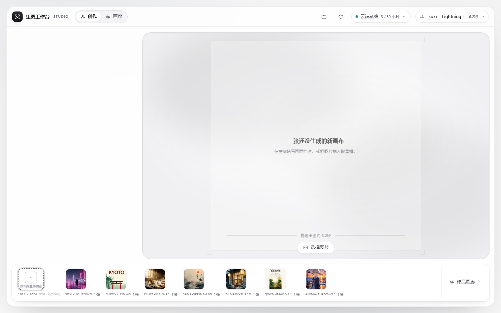
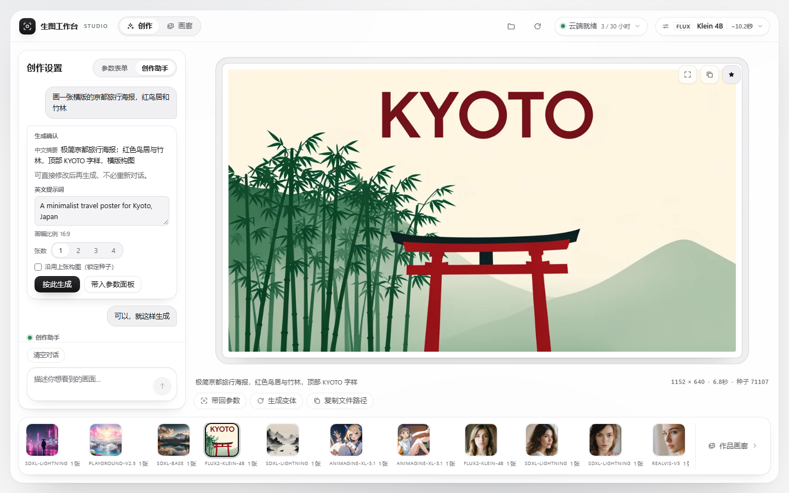
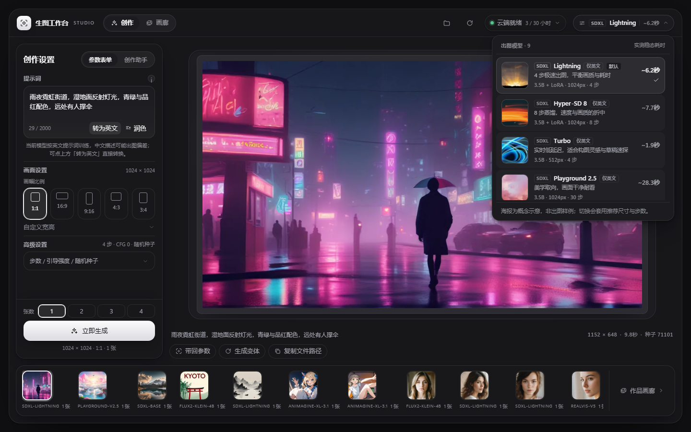
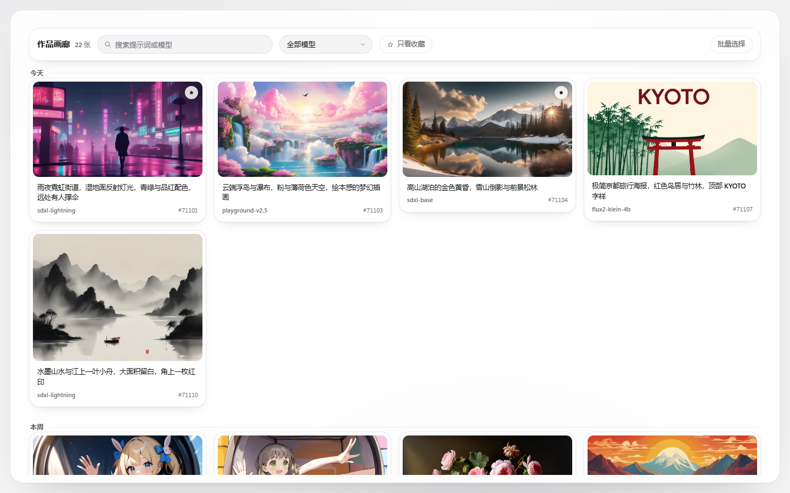

<div align="center">

# 生图工作台 (dsh-our-imagen)


**DeepSeek Harness 的开源文生图工作台与视觉 Agent 插件。**<br/>
默认使用 Kaggle 免费云端双卡 GPU（每周 30 小时），不占本机显存，生成的图片直接保存在本地。

[](#)
[](https://github.com/deepseek-ai/DeepSeek-Harness)
[](LICENSE)
[](https://github.com/nanxfu/dsh-our-imagen)
 <a href="https://linux.do/"></a>
> **当前处于 Preview 阶段**：默认内置 Kaggle 免费双卡 GPU 驱动，Colab 驱动已接入（大显存模型仅 Colab 可用），本地 GPU 与自建 Worker 支持在规划中。

[快速上手](#三步上手) · [算力后端](#算力后端支持) · [核心功能](#核心功能) · [模型示例](#模型示例) · [常见问答](#常见问答) · [开发与测试](#开发与测试) · [English](README.en.md)

</div>

---

## 简介

**生图工作台**（`dsh-our-imagen`）是运行在 [DeepSeek Harness (DSH)](https://github.com/deepseek-ai/DeepSeek-Harness) 上的文生图插件。

很多机器没有大显存独显，或者不想在本地折腾 PyTorch、CUDA 和 ComfyUI 环境。这个插件把**交互界面**和**算力后端**拆开：本地只跑一个轻量面板，推理放到云端免费 GPU 上，出图后直接写回本地工作区的 `imagen-output/` 目录。

---

## 算力后端支持

| 后端驱动 | 状态 | 算力规格 | 成本 / 门槛 | 说明 |
| :--- | :---: | :--- | :--- | :--- |
| **Kaggle GPU Driver** | **已内置 (默认)** | 2×Nvidia Tesla T4 (30G 显存) | **免费**（每周 30 小时额度） | 开箱即用，自动会话管理与加密回传 |
| **Google Colab Driver** | **已接入** | Nvidia T4（免费）/ L4、A100（Colab Pro） | 免费 / 订阅 | Notebook 挂载与隧道直连；`Z-Image Turbo`、`Qwen-Image 2.1`、`FLUX.2 Klein 9B` 显存需求更高，仅此来源可用 |
| **自建远端 Worker** | **规划中** | 自建服务器 / AutoDL / RunPod | 按需计费 / 私有部署 | 适合有私有 GPU 或需要长驻服务的用户 |
| **本地直连 (Local/ComfyUI)** | **规划中** | 本机独显 (RTX 3060/4090 等) | 本地硬件 | 适合本地大显存显卡，离线低延迟 |

**切换到 Colab**：运行设置 → 算力来源选 `Colab Pro（需授权）` →「Google / Colab 授权」点「在浏览器中授权」，凭据写入 `%USERPROFILE%\.imagen\colab-credentials.json`；可选 GPU 档位 T4 / L4 / A100 与高内存机型。`Z-Image Turbo`、`Qwen-Image 2.1`、`FLUX.2 Klein 9B` 需要切换到 Colab 才能在模型卡中选择。

---

## 核心功能

<table>
<tr>
<td width="48%">

### 1. 独立工作台
* **内置 7 款现代开源模型**：极速与通用（`SDXL Lightning`、`SANA-Sprint 1.6B`、`Z-Image Turbo`）、参考与扩图（`FLUX.2 Klein 4B`、`FLUX.2 Klein 9B`、`Qwen-Image 2.1`）、二次元专项（`Anima Turbo v1.1`）；名称、架构与定位以 [`models/*.json`](models/) 为准。
* **双算力来源**：`SDXL Lightning`、`SANA-Sprint 1.6B`、`FLUX.2 Klein 4B`、`Anima Turbo v1.1` 可在 Kaggle 免费 T4 与 Colab 运行；`Z-Image Turbo`、`Qwen-Image 2.1`、`FLUX.2 Klein 9B` 显存需求更高，仅 Colab 可用（模型卡标「仅 Colab」并置灰）。
* **干净的参数面板**：提示词、画幅比例、分辨率、步数、引导强度和随机种子集中在一个面板里，生成张数（1~4）常驻页脚。
* **只显示生效参数**：模型不消费负向词或默认引导强度为 0 时，排除项自动隐藏且不提交；参考图、局部重绘与扩图入口只在当前模型真正支持时出现。
* **快捷词缀**：光影、材质、构图、氛围四类常用英文短语一键追加（界面显示中文标签），支持收起/展开。
* **舞台图片工具**：选中作品后点下方的「局部涂抹 / 整图重绘」就地编辑，画布与提交栏内置修改描述、重绘强度与模型切换；画廊与大图的「以此图重绘」一步直达局部涂抹。高清放大（Real-ESRGAN ×2）与扩图（`FLUX.2 Klein 4B` + Outpaint LoRA）已接入，产物作为子版本归档。
* **作品条与版本树**：底部作品条按版本树折叠，`⎇ N` 角标展开版本派生面板，涂抹 / 整图重绘产出的图自动成为 v2/v3 子版本；每张作品的未提交编辑草稿有圆点标记，切换作品不丢笔迹。支持一键带回全部参数或生成变体；画廊按日期归档，支持搜索、收藏、批量选择与单张删除。

</td>
<td width="52%">

<div align="center">
  
  <p><sub>独立工作台：参数面板 + 实时画布 + 最近胶卷</sub></p>
</div>

</td>
</tr>

<tr>
<td width="48%">

### 2. 对话生图与创作助手
* **对话直接调用**：宿主自动挂载 `imagen_generate`、`imagen_batch`、`imagen_recipes`、`imagen_session`、`imagen_history` 等工具，在聊天窗口里直接说需求就能出图；一句话可以规划一组配图或分镜，配方库只提供可见的提示词模板，不做暗箱拼接。
* **先确认再执行**：内置助手会把自然语言翻译成英文提示词、推断比例并检查当前模型的参数限制，先给出确认卡片，点确定后再跑。
* **模型适配提醒**：助手了解 7 款模型的提示词习惯与专长，如果当前模型不太适合你的描述，会给出提示。
* **工作台联动**：确认卡可以一键带入参数面板继续精调；聊天里生成的图片也可以直接在工作台里打开做二次编辑。

</td>
<td width="52%">

<div align="center">
  
  <p><sub>对话卡片：先给确认卡，点确定即出图</sub></p>
</div>

</td>
</tr>

<tr>
<td width="48%">

### 3. 本地落盘与自动保活
* **图片只存本地**：生成结果通过单次随机 Bearer Token 隧道直接写入本地 `imagen-output/`，不经过第三方公共图床。
* **空闲自动关机**：云端 Kernel 空闲超过 30 分钟（可在设置中调整）自动关机，也可以在右上角随时手动关机，避免白白消耗额度。
* **断线重连**：本地 `.imagen/session.json` 会记录当前会话状态，DSH 重启或刷新后会自动探活并接管旧实例，不会重复开机。

</td>
<td width="52%">

```text
[ DSH 工作台 / 聊天窗口 ]
          │  /imagen-api/* (本地通信)
          ▼
[ 本地插件 Host (Node.js) ] ── (写入) ──▶ [ 本地 imagen-output/ ]
          │  kaggle kernels push
          ▼
[ Kaggle 云端 (2×Tesla T4) ]
   daemon.py (diffusers)
          │  单次 Bearer Token 加密隧道
          └─────────────────────────────▶ (直接回传本地)
```

</td>
</tr>
</table>
---

## 界面速览

<table>
<tr>
<td width="50%">

<div align="center">
  
  <p><sub>深色主题模型选择卡：内置模型对比与实测耗时</sub></p>
</div>

</td>
<td width="50%">

<div align="center">
  
  <p><sub>作品画廊：按日期归档，支持搜索、收藏、批量选择与单张删除</sub></p>
</div>

</td>
</tr>
</table>


---

## 模型示例

以下 7 张样张均由本插件真机生成，仅转存为 WebP，未做后期修图；各模型分别按自身擅长题材（街景、水墨、中英排版、静物光影、二次元角色等）生成，耗时为当次生成记录（`Z-Image Turbo`、`Qwen-Image 2.1` 经同尺寸预热，贴近模型卡稳态读数）：

<table>
<tr>
<td width="33.3%">
<div align="center">
  
  <p><sub>SDXL Lightning · 雨夜霓虹街道 · 约 9.8 秒</sub></p>
</div>
</td>
<td width="33.3%">
<div align="center">
  
  <p><sub>SANA-Sprint 1.6B · 红冠鹤与晨间荷塘 · Colab L4 · 4.07 秒</sub></p>
</div>
</td>
<td width="33.3%">
<div align="center">
  
  <p><sub>Z-Image Turbo · 雨巷旧书店 · Colab L4 · 29.19 秒</sub></p>
</div>
</td>
</tr>

<tr>
<td width="33.3%">
<div align="center">
  
  <p><sub>Qwen-Image 2.1 · 温室植物志海报 · Colab L4 · 39.25 秒</sub></p>
</div>
</td>
<td width="33.3%">
<div align="center">
  
  <p><sub>FLUX.2 Klein 4B · 极简京都旅行海报 · Kaggle 2×T4 · 约 6.8 秒</sub></p>
</div>
</td>
<td width="33.3%">
<div align="center">
  
  <p><sub>FLUX.2 Klein 9B · 黄金时刻钟表匠工作台 · Colab L4 · 113.1 秒</sub></p>
</div>
</td>
</tr>
</table>

<table>
<tr>
<td width="33.3%"></td>
<td width="33.3%">
<div align="center">
  
  <p><sub>Anima Turbo v1.1 · 黄昏海边站台少女 · Colab L4 · 9.81 秒</sub></p>
</div>
</td>
<td width="33.3%"></td>
</tr>
</table>


---

## 三步上手

### 第一步：准备 Kaggle 凭据

> 提示：Kaggle 账号需要在个人设置里完成**手机号绑定验证**（Phone Verification），平台才会分配免费 GPU；未绑定的账号会被降级为纯 CPU。

**方式 1：免装 CLI，直接在工作台浏览器登录**
打开工作台 → 顶栏「GPU 状态」→「运行设置」→「高级」→「Kaggle 访问方式」选**直连**，然后点击指引卡上的「在浏览器中登录 Kaggle」完成 OAuth 授权即可（凭据会写入 `%USERPROFILE%\.kaggle\credentials.json`）。命令行也可以运行 `node tools/kaggle-login.mjs`。

**方式 2：通过 kaggle CLI 2.x 登录**
```powershell
pip install -U kaggle
kaggle auth login
```
执行后会拉起浏览器完成 OAuth 授权，并自动把凭据写入 `%USERPROFILE%\.kaggle\credentials.json`。

**方式 3：手动配置 API Token（旧版 CLI）**
1. 打开 [Kaggle API Settings](https://www.kaggle.com/settings/api)，点击 **Create New Token**。
2. 将拿到的 Token 写入本地文件：
   * **Windows (PowerShell)**：
     ```powershell
     New-Item -ItemType Directory -Force "$env:USERPROFILE\.kaggle" | Out-Null
     Set-Content -NoNewline "$env:USERPROFILE\.kaggle\access_token" "你的_Kaggle_Token"
     ```
   * **macOS / Linux (Bash / Zsh)**：
     ```bash
     mkdir -p ~/.kaggle
     printf '%s' '你的_Kaggle_Token' > ~/.kaggle/access_token
     chmod 600 ~/.kaggle/access_token
     ```

验证：运行 `kaggle quota` 能打印 GPU/TPU 配额即配置成功。

---

### 第二步：在 DSH 中安装插件

把下面命令里的 `web` 换成你的 profile 名（DSH Desktop 客户端通常是 `desktop`）：

* **方式 A（推荐）：通过 npm 安装**
  ```bash
  dsh plugin --profile web add dsh-our-imagen
  ```
  升级：先 `dsh plugin --profile web remove dsh-our-imagen`，再重新安装并重启 DSH。也可以在 **1024 插件市场（deepseek1024.com）** 搜索 `dsh-our-imagen` 一键安装。

* **方式 B：从 GitHub 或图形界面安装**
  ```bash
  dsh plugin --profile web add github:nanxfu/dsh-our-imagen
  ```
  图形界面：DSH 设置 → **插件管理** → **安装插件**，粘贴 `dsh-our-imagen` 或 `github:nanxfu/dsh-our-imagen`，安装后重启 DSH。

* **方式 C：Release tarball（适合 GitHub 直连不稳定的网络）**
  ```bash
  dsh plugin --profile web add https://github.com/nanxfu/dsh-our-imagen/releases/download/v0.14.0/dsh-our-imagen-0.14.0.tgz
  ```

* **方式 D：离线 zip + 本地加载（Load Bundle）**
  1. 从 [Releases](https://github.com/nanxfu/dsh-our-imagen/releases) 下载 `dsh-our-imagen-<version>.zip` 并解压；
  2. DSH 设置 → **插件管理** → **本地加载（Load Bundle）**，选中解压后的目录；
  3. 点击左侧工具栏新增的「生图工作台」图标。

* **方式 E：本地源码 link（开发调试）**
  ```bash
  dsh plugin --profile desktop add D:\path\to\dsh-our-imagen
  ```

---

### 第三步：唤醒云端并出图

1. 进入工作台，点击顶部的 **开机 / 唤醒云端**；
2. 首次开机 Kaggle 约需 3~10 分钟分配资源并加载模型权重；
3. 状态变为 `Online` 后即可开始生成，稳态下每张图只需数秒。

---

## 常见问答

<details>
<summary><b>Q1: 使用这个插件要花钱吗？每周 30 小时 GPU 够用吗？</b></summary>

完全免费。插件本身以 MIT 协议开源，算力使用 Kaggle 向已验证手机号的用户每周免费提供的 **30 小时 GPU（2×Nvidia T4）**。按常规出图频率，个人日常创作基本用不完。
</details>

<details>
<summary><b>Q2: 我的电脑需要独立显卡吗？</b></summary>

不需要。模型加载和推理都在云端（Kaggle 或 Colab）执行，本地只负责显示界面和保存图片。
</details>

<details>
<summary><b>Q3: 首次开机为什么需要等几分钟？</b></summary>

云端冷启动包含三步：分配云端实例（Kaggle 2×T4，或 Colab 的 L4 / A100）、检查运行环境、下载并加载模型权重，通常需要 3~10 分钟。就绪后连续生成无需再等，插件默认 30 分钟空闲自动关机，也可以随时手动关机。
</details>

<details>
<summary><b>Q4: 图片会传到第三方图床吗？</b></summary>

不会。远端生成的图片只通过当次会话的临时 Bearer Token 隧道传回本地 Host，直接保存到本地工作区的 `imagen-output/` 目录。
</details>

<details>
<summary><b>Q5: 目前内置了哪些模型？</b></summary>

配置定义在 [`models/*.json`](models/)，当前 7 款：

| 模型 | 定位 | 算力来源 | 许可 |
| :--- | :--- | :--- | :--- |
| `SDXL Lightning` | 默认；SDXL + 4 步 LoRA，极速出图，支持图生图 / 局部重绘 | Kaggle / Colab | OpenRAIL++ |
| `SANA-Sprint 1.6B` | 1.6B 线性 DiT，2 步超快 1024px 生成，轻量灵感探索 | Kaggle / Colab | Apache-2.0 |
| `Z-Image Turbo` | 6B S3-DiT，写实摄影、中英双语文字与局部重绘 | 仅 Colab | Apache-2.0 |
| `Qwen-Image 2.1` | 7B DiT + Qwen3-VL，强排版、多图参考编辑；参考图支持 RGBA 输入 | 仅 Colab | Qwen Research License（非商用） |
| `FLUX.2 Klein 4B` | 轻量新一代架构，多图参考 + 扩图引擎（Outpaint LoRA） | Kaggle / Colab | Apache-2.0 |
| `FLUX.2 Klein 9B` | 9B 蒸馏编辑模型，4 步出图、参考编辑 | 仅 Colab（HF gated） | FLUX Non-Commercial |
| `Anima Turbo v1.1` | 2B 二次元 DiT，支持自然语言与 Danbooru 标签 | Kaggle / Colab | CircleStone Labs 非商用 |

已下线的旧模型：`SDXL Turbo`、`Hyper-SDXL 8-Step`、`SDXL Base 1.0`、`Playground v2.5`、`RealVisXL V5.0`、`Animagine XL 3.1`、`SDXL Inpaint`、`Anima Light Lavender`。
</details>

---

## 开发与测试

| 操作 | 命令 | 说明 |
| :--- | :--- | :--- |
| **安装依赖** | `npm install` | 安装开发与打包依赖 |
| **运行全部测试** | `npm test` | 构建前端并运行契约、Host、Client 与 Python 远端单测 |
| **契约测试** | `npm run test:contract` | 校验模型配置与接口契约 |
| **离线联调** | `node test/mock-daemon.mjs` | 本地模拟云端通信，无需真实 Kaggle 算力 |
| **构建工作台** | `node build.mjs` | 编译前端单文件 Bundle `client.js` |
| **预览与截图** | `node tools/preview.mjs --shot` | 生成设计预览页（加 `--readme` 同时刷新 README 截图） |
| **生产打包** | `npm run package` | 生成可发布的 `dist/` 独立插件 Bundle |

---

## 关注作者

作者抖音账号：**Lumen流明**（抖音号 `42906749348`）。打开抖音「扫一扫」关注：

<div align="center">
  
</div>

---

## 开源许可与致谢

- 本项目基于 [MIT License](LICENSE) 开源。
- 感谢 [DeepSeek Harness (DSH)](https://github.com/deepseek-ai/DeepSeek-Harness) 团队提供插件扩展体系与设计规范。
- 感谢 Kaggle 为开发者提供免费 GPU 算力。
- 感谢 Hugging Face diffusers 与各大开源模型团队（Stability AI、ByteDance、Efficient-Large-Model、通义万相、Black Forest Labs、CircleStone Labs 等）。
