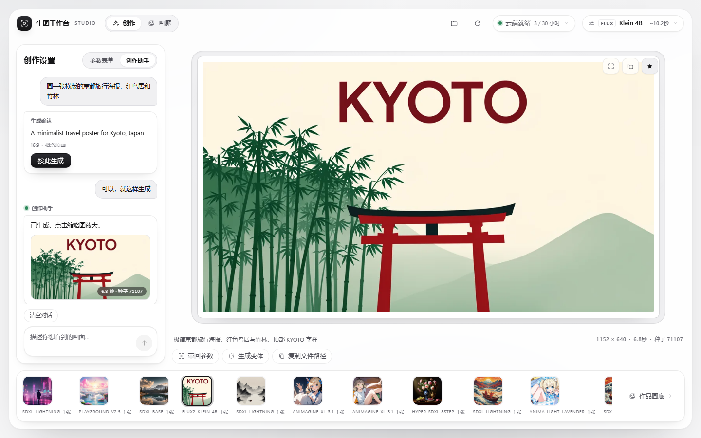

<div align="center">

# 生图工作台 (dsh-our-imagen)

**借 Kaggle 每周免费 30 小时 GPU，在 DeepSeek Harness 里免费出图。**<br/>
不吃本机显卡，开机一次随画随出，图片全部直接落盘在本地。

[](#)
[](https://github.com/deepseek-ai/DeepSeek-Harness)
[](LICENSE)
[](https://github.com/yourusername/dsh-our-imagen)

> 🚧 **当前处于 Preview 早期预览阶段**：部分复杂网络环境下的保活机制正在持续打磨。更稳定的插件版本、更强大的开源生图模型（如更高画质与长文本驱动的新架构）正在紧密接入中，欢迎体验与反馈 issue！

[快速上手](#-三步上手) · [它是什么](#-它是什么) · [问答](#-常见问答) · [开发与测试](#-开发与测试) · [English](README.en.md)

</div>

---

## 💡 它是什么

**生图工作台**（仓库：`dsh-our-imagen`）是运行在 [DeepSeek Harness (DSH)](https://github.com/deepseek-ai/DeepSeek-Harness) 上的开源文生图工作台插件。

它解决一个很实在的问题：很多人想在本地用开源大模型画图，但自己的笔记本或台式机没有大显存独显，或者懒得在本地折腾一套数百兆甚至数千兆的 PyTorch、CUDA、ComfyUI 环境。

装上它之后：
1. **你得到一个整页可视化工作台**：开机唤醒 Kaggle 2×T4 云端算力，选好模型、敲下灵感、一键生图；
2. **你得到一组开箱即用的对话工具**：在聊天窗口里直接跟 AI 说「帮我画一张赛博朋克雨夜街道」，Agent 会自动整理参数、展示确认卡片并调用云端生成；
3. **不用担心算力浪费与图床隐私**：空闲 30 分钟自动关机，图片通过加密安全隧道直接存进你本地工作区的 `imagen-output/` 文件夹。

---

## 🎨 核心能力

<table>
<tr>
<td width="48%">

### 1. 独立整页工作台
* **多款实测开源模型卡片**：从疾速出图的 `SDXL Lightning`、`Hyper-SDXL`，到画风扎实的 `SDXL Base`、`RealVisXL`，再到动漫专项 `Animagine XL 3.1` 与轻量前沿 `FLUX.2 Klein 4B` 等。
* **单轨专注面板**：提示词、反向词、尺寸比例（1:1 / 16:9 / 9:16 / 4:3 / 3:4）、步数、随机种子一目了然。
* **四维轻量润色**：光影、材质、构图、氛围一键追加，不破坏原生提示词意图。
* **底栏轻胶卷与历史抽屉**：刚生成的图随时回看，支持一键「带回全部参数」与「继续生成变体」。

</td>
<td width="52%">

<!-- 建议将真实截图命名为 studio.png 放置于 docs/assets/ -->
<div align="center">
  
  <p><sub>独立整页工作台：参数面板 + 实时画布 + 最近胶卷</sub></p>
</div>

</td>
</tr>

<tr>
<td width="48%">

### 2. 创作助手与对话调用
* **对话直接出图**：宿主自动挂载 `imagen_generate`、`imagen_session`、`imagen_history` 等工具，与你的日常对话无缝集成。
* **自然语言意图对齐**：随口说一句画面想法，内置创作助手先帮你翻译为规范的英文提示词、推断合适的比例与推荐模型，**先出确认卡片，确认后再跑**。
* **双向无缝流转**：聊天中生成的图片，随时可在右侧胶卷点击展开并在整页工作台里二次编辑。

</td>
<td width="52%">

<!-- 建议将真实截图命名为 chat-tool.png 放置于 docs/assets/ -->
<div align="center">
  
  <p><sub>对话卡片：先给确认卡，点确定即出图，成果进本地工作区</sub></p>
</div>

</td>
</tr>

<tr>
<td width="48%">

### 3. 本地落盘与自愈防烧
* **资产 100% 留存本地**：生成完毕的数据流通过临时单次 Token 隧道直接写进你工作区的 `imagen-output/` 目录，不经过任何第三方公共商业图床。
* **省心防烧机制**：云端 Kernel 空闲超过 30 分钟（时间可配置）自动关机，或者在工作台右上角随时手动关机。
* **意外断点恢复**：本地实时记录 `.imagen/session.json`。DSH 重启或窗口刷新后，插件会自动探活旧实例并无缝接管，避免重复开机浪费额度。

</td>
<td width="52%">

```text
[ DSH 工作台 / 聊天窗口 ]
          │  /imagen-api/* (本地通信)
          ▼
[ 本地插件 Host (Node.js) ] ── (写入) ──▶ [ 本地 imagen-output/ ]
          │  kaggle kernels push
          ▼
[ Kaggle 云端 (2×Tesla T4) ]
   daemon.py (diffusers)
          │  单次 Bearer Token 加密隧道
          └─────────────────────────────▶ (安全返回本地)
```

</td>
</tr>
</table>

---

## ⚡ 三步上手

### 第一步：准备 Kaggle Token

> 提示：Kaggle 账号必须在个人设置里完成**手机号绑定验证**（Phone Verification），平台才会给分配免费 GPU；未绑定的账号会被降级为纯 CPU。

1. 打开 [Kaggle API Settings](https://www.kaggle.com/settings/api)，点击 **Create New Token**。
2. 拿到你的 Token（或 `kaggle.json`），写入本地配置文件：

* **Windows (PowerShell)**：
  ```powershell
  New-Item -ItemType Directory -Force "$env:USERPROFILE\.kaggle" | Out-Null
  Set-Content -NoNewline "$env:USERPROFILE\.kaggle\access_token" "你的_Kaggle_Token"
  ```
* **macOS / Linux (Bash / Zsh)**：
  ```bash
  mkdir -p ~/.kaggle
  printf '%s' '你的_Kaggle_Token' > ~/.kaggle/access_token
  chmod 600 ~/.kaggle/access_token
  ```

---

### 第二步：在 DSH 中加载插件

你可以任选下面一种方式：

* **方式 A：1024 插件市场或 CLI 安装**（推荐）：
  ```bash
  dsh plugin --profile web add dsh-our-free-imagen
  ```
* **方式 B：本地源码或 Release Bundle 加载**：
  1. 下载 Release 里的 `dist/dsh-our-free-imagen-<version>.zip` 并解压（或克隆本仓库后执行 `npm install && npm run package`）；
  2. 打开 DSH 设置 → **插件管理** → 选择 **本地加载（Load Bundle）** 选中该目录；
  3. 点击左侧工具栏新增的 **生图工作台** 图标。

---

### 第三步：点击唤醒并开始出图

1. 进入工作台，点击顶部的 **开机 / 唤醒云端**；
2. 首次开机 Kaggle 约需 3~10 分钟分配资源并加载模型权重；
3. 云端就绪变绿（`Online`）后，随写随出，每张仅需数秒。

---

## ❓ 常见问答

<details>
<summary><b>Q1: 使用这个插件要花钱吗？每周 30 小时 GPU 够用吗？</b></summary>

**完全免费，且额度非常充裕。**
- 插件代码采用宽松的 MIT 协议开源。
- 算力直接借用 Kaggle 平台向所有通过手机认证用户每周免费赠送的 **30 小时 GPU（2×Nvidia T4）**，额度内完全不花一分钱。
- **每周能出多少张图？**
  - 以日常主力 1024 高清模型（`SDXL Lightning` 1024px，实测约 6.2 秒/张）为例，30 小时额度**每周最高可出图 17,000+ 张**；
  - 即使每天重度画图几十到上百张，一周通常也只消耗 1~2 小时额度，日常个人创作额度根本用不完。
</details>

<details>
<summary><b>Q2: 我的电脑需要配独立显卡吗？</b></summary>

**完全不需要。**
所有的模型加载与扩散去噪推理都在 Kaggle 的云端双卡 T4 上执行。你的本地电脑（甚至是轻薄办公本）只负责显示工作台界面以及把图片写到硬盘里。
</details>

<details>
<summary><b>Q3: 首次开机为什么需要等几分钟？</b></summary>

云端冷启动包含几个固定步骤：
1. Kaggle 调度分配免费 2×T4 虚拟机；
2. 远端运行环境初始化与依赖检查；
3. 下载并装载所选模型权重（若未挂载缓存数据集）。
这个过程通常需要 3~10 分钟。**一旦就绪，后续连续生成无需等待，稳态下每张图只需要数秒。** 插件提供了 30 分钟空闲保活，用完也可以随时点击关机。
</details>

<details>
<summary><b>Q4: 我的图片会传到第三方云盘或公共图床吗？</b></summary>

**不会。**
远端生成完毕的图像数据，只通过该次会话随机生成的专属 Bearer Token 隧道直接流式传回本地 Host，并直接保存到你电脑的 `imagen-output/` 文件夹下。没有中间商业图床，也不保留公开访问链接。
</details>

<details>
<summary><b>Q5: 支持哪些模型？</b></summary>

目前开箱内置多款实测可用的模型配置（定义在 [`models/*.json`](models/)）：
- `SDXL Lightning`（默认，4 步疾速，~2s/张）
- `Hyper-SDXL 8-Step`（兼顾细节与速度，~2.5s/张）
- `SDXL Turbo`（实时去噪，极速草图）
- `Playground v2.5`（美感表现优异，色彩丰富）
- `SDXL Base 1.0`（经典标准底模）
- `RealVisXL V5.0`（写实人像与摄影质感专项）
- `FLUX.2 Klein 4B`（轻量新一代扩散模型架构）
- `Animagine XL 3.1`（二次元与动漫风格专项）
- `Anima Light Lavender`（二次元插画专项，Cosmos-Predict2 2B 底座）
</details>

---

## 🛠 开发与测试

如果你想修改代码、贡献新功能或调试模型：

| 操作 | 命令 | 说明 |
| :--- | :--- | :--- |
| **安装依赖** | `npm install` | 安装开发与打包依赖 |
| **运行单元测试** | `npm test` | 校验核心状态机与工作流逻辑 |
| **契约测试** | `npm run test:contract` | 校验全套模型配置与接口契约 |
| **离线联调** | `node test/mock-daemon.mjs` | 本地模拟云端双向通信，无需真实 Kaggle 算力 |
| **构建工作台** | `node build.mjs` | 编译前端单文件 Bundle `client.js` |
| **生产打包** | `npm run package` | 生成可发布的 `dist/` 独立插件 Bundle |

---

## 📄 开源许可与致谢

- 本项目基于 [MIT License](LICENSE) 开源。
- 感谢 [DeepSeek Harness (DSH)](https://github.com/deepseek-ai/DeepSeek-Harness) 团队提供出色的宿主扩展体系与设计规范。
- 感谢 Kaggle 为全球开发者提供稳定的免费 GPU 算力支持。
- 感谢 Hugging Face diffusers 与各大开源模型团队（Stability AI、ByteDance、Playground AI、CagliostroLab 等）。
