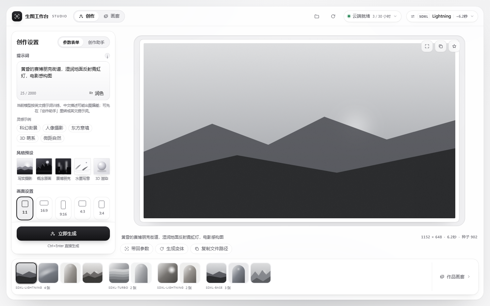
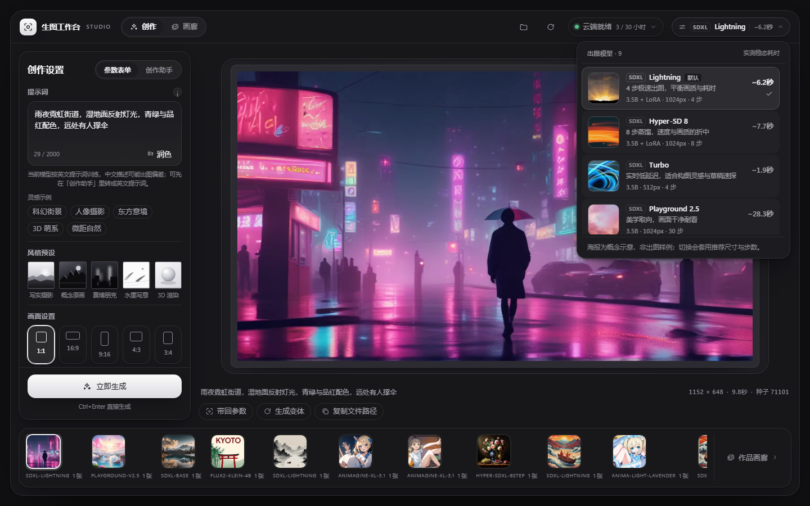
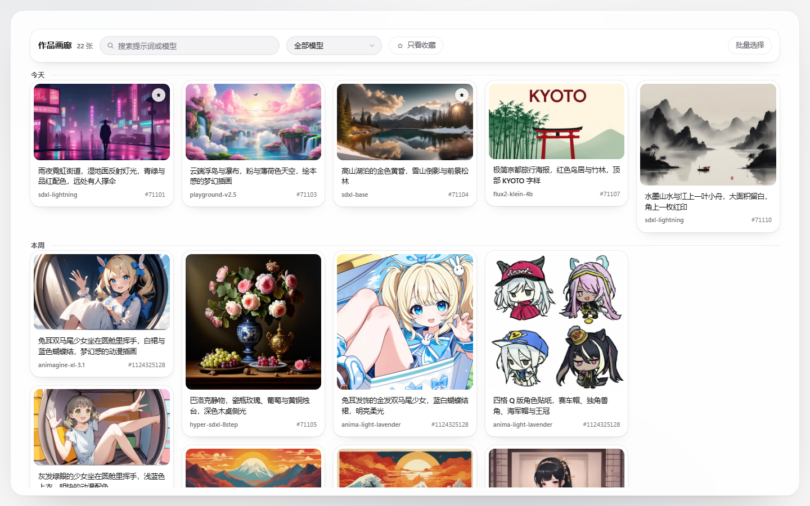

<div align="center">

# 生图工作台 (dsh-our-imagen)

**DeepSeek Harness 的开源文生图工作台与 Agent 视觉工具。**<br/>
首发支持 Kaggle 免费云端双卡 GPU（每周赠送 30 小时），不吃本机显卡，开机随画随出，图片全部直接落盘在本地。

[](#)
[](https://github.com/deepseek-ai/DeepSeek-Harness)
[](LICENSE)
[](https://github.com/nanxfu/dsh-our-imagen)

> 🚧 **当前处于 Preview 早期预览阶段**：可插拔后端架构正在演进，首发默认驱动为 Kaggle 免费双卡 GPU；Colab、本地 GPU 及自建 Worker 支持正在接入中。更稳定的插件版本、更多前沿模型正在持续更新，欢迎体验与反馈 issue！

[快速上手](#-三步上手) · [它是什么](#-它是什么) · [后端支持](#-算力后端支持) · [问答](#-常见问答) · [开发与测试](#-开发与测试) · [English](README.en.md)

</div>

---

## 💡 它是什么

**生图工作台**（仓库：`dsh-our-imagen`）是运行在 [DeepSeek Harness (DSH)](https://github.com/deepseek-ai/DeepSeek-Harness) 上的开源文生图工作台与视觉 Agent 插件。

它解决一个很实在的问题：很多人想在本地用开源大模型画图，但自己的笔记本或台式机没有大显存独显，或者懒得在本地折腾一套数百兆甚至数千兆的 PyTorch、CUDA、ComfyUI 环境。

本插件采用**宿主工作台与算力后端解耦**的可插拔设计：
1. **你得到一个整页可视化工作台**：开机唤醒云端算力，选好模型、敲下灵感、一键生图；
2. **你得到一组开箱即用的对话工具**：在聊天窗口里直接跟 AI 说「帮我画一张赛博朋克雨夜街道」，Agent 会自动整理参数、展示确认卡片并调用算力生成；
3. **零门槛免费算力驱动**：首发提供开箱即用的 Kaggle 2×T4 免费云端驱动（每周 30 小时免费额度），后续将陆续接入 Google Colab 等免费/自建后端；
4. **不用担心算力浪费与图床隐私**：空闲 30 分钟自动关机，图片通过加密安全隧道直接存进你本地工作区的 `imagen-output/` 文件夹。

---

## 🔌 算力后端支持 (Backend Drivers)

本插件将文生图交互界面与底层推理引擎解耦，支持按需接入不同的算力驱动：

| 后端驱动 | 状态 | 算力规格 | 成本 / 门槛 | 说明 |
| :--- | :---: | :--- | :--- | :--- |
| **Kaggle GPU Driver** | **已内置 (默认)** | 2×Nvidia Tesla T4 (30G 显存) | **完全免费**（每周 30 小时额度） | 首发开箱即用，零本地显存负担，自动会合与加密直连 |
| **Google Colab Driver** | **接入中** | Nvidia T4 / A100 | **免费 / 订阅** | 一键 Notebook 挂载与隧道直连，丰富免费算力来源 |
| **自建远端 Worker** | **规划中** | 自建服务器 / AutoDL / RunPod | 按需计费 / 私有部署 | 适合拥有私有 GPU 服务器或需要长驻不关机的创作者 |
| **本地直连 (Local/ComfyUI)** | **规划中** | 本机独显 (RTX 3060/4090 等) | 本地硬件 | 适合拥有本地大显存显卡、追求绝对零延迟与离线运行的用户 |

---

## 🎨 核心能力

<table>
<tr>
<td width="48%">

### 1. 独立整页工作台
* **多款实测开源模型卡片**：从疾速出图的 `SDXL Lightning`、`Hyper-SDXL`，到画风扎实的 `SDXL Base`、`RealVisXL`，再到动漫专项 `Animagine XL 3.1` 与轻量前沿 `FLUX.2 Klein 4B` 等。
* **单轨专注面板**：提示词、反向词、尺寸比例（1:1 / 16:9 / 9:16 / 4:3 / 3:4）、步数、随机种子一目了然。
* **四维轻量润色**：光影、材质、构图、氛围一键追加；追加进提示词的是英文短语，界面显示中文标签，不破坏原生提示词意图。
* **底栏轻胶卷与历史抽屉**：刚生成的图随时回看，支持一键「带回全部参数」与「继续生成变体」。

</td>
<td width="52%">

<div align="center">
  
  <p><sub>独立整页工作台：参数面板 + 实时画布 + 最近胶卷</sub></p>
</div>

</td>
</tr>

<tr>
<td width="48%">

### 2. 创作助手与对话调用
* **对话直接出图**：宿主自动挂载 `imagen_generate`、`imagen_session`、`imagen_history` 等工具，与你的日常对话无缝集成。
* **自然语言意图对齐**：随口说一句画面想法，内置创作助手先帮你翻译为规范的英文提示词、推断合适的比例与推荐模型，**先出确认卡片，确认后再跑**。
* **双向无缝流转**：聊天中生成的图片，随时可在右侧胶卷点击展开并在整页工作台里二次编辑。

</td>
<td width="52%">

<div align="center">
  
  <p><sub>对话卡片：先给确认卡，点确定即出图，成果进本地工作区</sub></p>
</div>

</td>
</tr>

<tr>
<td width="48%">

### 3. 本地落盘与自愈防烧
* **资产 100% 留存本地**：生成完毕的数据流通过临时单次 Token 隧道直接写进你工作区的 `imagen-output/` 目录，不经过任何第三方公共商业图床。
* **省心防烧机制**：云端 Kernel 空闲超过 30 分钟（时间可配置）自动关机，或者在工作台右上角随时手动关机。
* **意外断点恢复**：本地实时记录 `.imagen/session.json`。DSH 重启或窗口刷新后，插件会自动探活旧实例并无缝接管，避免重复开机浪费额度。

</td>
<td width="52%">

```text
[ DSH 工作台 / 聊天窗口 ]
          │  /imagen-api/* (本地通信)
          ▼
[ 本地插件 Host (Node.js) ] ── (写入) ──▶ [ 本地 imagen-output/ ]
          │  kaggle kernels push
          ▼
[ Kaggle 云端 (2×Tesla T4) ]
   daemon.py (diffusers)
          │  单次 Bearer Token 加密隧道
          └─────────────────────────────▶ (安全返回本地)
```

</td>
</tr>
</table>

---

## 🖼 界面速览

<table>
<tr>
<td width="50%">

<div align="center">
  
  <p><sub>深色主题的模型选择卡：九款内置模型逐一对比，标注实测出图耗时</sub></p>
</div>

</td>
<td width="50%">

<div align="center">
  
  <p><sub>作品画廊：按日期归档，支持搜索、收藏与批量选择</sub></p>
</div>

</td>
</tr>
</table>

---

## 🎨 模型示例

以下 9 张样张按内置模型逐一给出，均由本插件调用 Kaggle 2×T4 实际生成，仅转存为 WebP，未做后期修图；耗时取自当次生成记录。

<table>
<tr>
<td width="33.3%">
<div align="center">
  
  <p><sub>SDXL Lightning · 雨夜霓虹街道 · 约 9.8 秒</sub></p>
</div>
</td>
<td width="33.3%">
<div align="center">
  
  <p><sub>Hyper-SDXL 8-Step · 巴洛克静物 · 约 8.0 秒</sub></p>
</div>
</td>
<td width="33.3%">
<div align="center">
  
  <p><sub>SDXL Turbo · 赤月下的武士 · 约 3.9 秒</sub></p>
</div>
</td>
</tr>

<tr>
<td width="33.3%">
<div align="center">
  
  <p><sub>Playground v2.5 · 云端瀑布梦境 · 约 19.6 秒</sub></p>
</div>
</td>
<td width="33.3%">
<div align="center">
  
  <p><sub>SDXL Base 1.0 · 高山湖泊的金色黄昏 · 约 17.1 秒</sub></p>
</div>
</td>
<td width="33.3%">
<div align="center">
  
  <p><sub>RealVisXL V5.0 · 海边老渔民肖像 · 约 21.1 秒</sub></p>
</div>
</td>
</tr>

<tr>
<td width="33.3%">
<div align="center">
  
  <p><sub>FLUX.2 Klein 4B · 极简京都旅行海报 · 约 6.8 秒</sub></p>
</div>
</td>
<td width="33.3%">
<div align="center">
  
  <p><sub>Animagine XL 3.1 · 樱花巷口的少女 · 约 21.1 秒</sub></p>
</div>
</td>
<td width="33.3%">
<div align="center">
  
  <p><sub>Anima Light Lavender · 薰衣草花田的黄昏 · 约 63.4 秒</sub></p>
</div>
</td>
</tr>
</table>

---

## ⚡ 三步上手

### 第一步：准备 Kaggle Token

> 提示：Kaggle 账号必须在个人设置里完成**手机号绑定验证**（Phone Verification），平台才会给分配免费 GPU；未绑定的账号会被降级为纯 CPU。

1. 打开 [Kaggle API Settings](https://www.kaggle.com/settings/api)，点击 **Create New Token**。
2. 拿到你的 Token（或 `kaggle.json`），写入本地配置文件：

* **Windows (PowerShell)**：
  ```powershell
  New-Item -ItemType Directory -Force "$env:USERPROFILE\.kaggle" | Out-Null
  Set-Content -NoNewline "$env:USERPROFILE\.kaggle\access_token" "你的_Kaggle_Token"
  ```
* **macOS / Linux (Bash / Zsh)**：
  ```bash
  mkdir -p ~/.kaggle
  printf '%s' '你的_Kaggle_Token' > ~/.kaggle/access_token
  chmod 600 ~/.kaggle/access_token
  ```

---

### 第二步：在 DSH 中加载插件

**推荐用下面两种方式安装**（都无需 npm 账号；把 `web` 换成你的 profile 名，DSH Desktop 客户端通常是 `desktop`）：

* **方式 A（推荐）：命令行一条命令从 GitHub 安装**
  ```bash
  dsh plugin --profile web add github:nanxfu/dsh-our-imagen
  ```
  升级：先 `dsh plugin --profile web remove dsh-our-free-imagen`，再执行上面的安装命令；安装或升级后重启 DSH。

* **方式 B（推荐）：图形界面安装**
  DSH 设置 → **插件管理** → **安装插件**，粘贴 `github:nanxfu/dsh-our-imagen` → 安装完成后重启 DSH。

网络受限或需要离线时，可改用：

* **方式 C：固定版本的 Release tarball**（只依赖 HTTPS，适合 GitHub 直连不稳定的网络）
  ```bash
  dsh plugin --profile web add https://github.com/nanxfu/dsh-our-imagen/releases/download/v0.7.0/dsh-our-free-imagen-0.7.0.tgz
  ```

* **方式 D：离线 zip + 本地加载（Load Bundle）**（完全离线可用）
  1. 从 [Releases](https://github.com/nanxfu/dsh-our-imagen/releases) 下载 `dsh-our-free-imagen-<version>.zip` 并解压；
  2. DSH 设置 → **插件管理** → **本地加载（Load Bundle）**，选中解压后的目录；
  3. 点击左侧工具栏新增的「生图工作台」图标。

* **方式 E：本地源码 link**（开发调试，改代码即时生效）
  ```bash
  dsh plugin --profile desktop add D:\path\to\our-free-imagen
  ```

> npm 包与 1024 插件市场暂未上架，以上方式都可以正常安装与使用。

---

### 第三步：点击唤醒并开始出图

1. 进入工作台，点击顶部的 **开机 / 唤醒云端**；
2. 首次开机 Kaggle 约需 3~10 分钟分配资源并加载模型权重；
3. 云端就绪变绿（`Online`）后，随写随出，每张仅需数秒。

---

## ❓ 常见问答

<details>
<summary><b>Q1: 使用这个插件要花钱吗？每周 30 小时 GPU 够用吗？</b></summary>

**完全免费，且额度非常充裕。**
- 插件代码采用宽松的 MIT 协议开源。
- 算力直接借用 Kaggle 平台向所有通过手机认证用户每周免费赠送的 **30 小时 GPU（2×Nvidia T4）**，额度内完全不花一分钱。
- **每周能出多少张图？**
  - 以日常主力 1024 高清模型（`SDXL Lightning` 1024px，实测约 6.2 秒/张）为例，30 小时额度**每周最高可出图 17,000+ 张**；
  - 即使每天重度画图几十到上百张，一周通常也只消耗 1~2 小时额度，日常个人创作额度根本用不完。
</details>

<details>
<summary><b>Q2: 我的电脑需要配独立显卡吗？</b></summary>

**完全不需要。**
所有的模型加载与扩散去噪推理都在 Kaggle 的云端双卡 T4 上执行。你的本地电脑（甚至是轻薄办公本）只负责显示工作台界面以及把图片写到硬盘里。
</details>

<details>
<summary><b>Q3: 首次开机为什么需要等几分钟？</b></summary>

云端冷启动包含几个固定步骤：
1. Kaggle 调度分配免费 2×T4 虚拟机；
2. 远端运行环境初始化与依赖检查；
3. 下载并装载所选模型权重（若未挂载缓存数据集）。
这个过程通常需要 3~10 分钟。**一旦就绪，后续连续生成无需等待，稳态下每张图只需要数秒。** 插件提供了 30 分钟空闲保活，用完也可以随时点击关机。
</details>

<details>
<summary><b>Q4: 我的图片会传到第三方云盘或公共图床吗？</b></summary>

**不会。**
远端生成完毕的图像数据，只通过该次会话随机生成的专属 Bearer Token 隧道直接流式传回本地 Host，并直接保存到你电脑的 `imagen-output/` 文件夹下。没有中间商业图床，也不保留公开访问链接。
</details>

<details>
<summary><b>Q5: 支持哪些模型？</b></summary>

目前开箱内置多款实测可用的模型配置（定义在 [`models/*.json`](models/)）：
- `SDXL Lightning`（默认，4 步疾速，~2s/张）
- `Hyper-SDXL 8-Step`（兼顾细节与速度，~2.5s/张）
- `SDXL Turbo`（实时去噪，极速草图）
- `Playground v2.5`（美感表现优异，色彩丰富）
- `SDXL Base 1.0`（经典标准底模）
- `RealVisXL V5.0`（写实人像与摄影质感专项）
- `FLUX.2 Klein 4B`（轻量新一代扩散模型架构）
- `Animagine XL 3.1`（二次元与动漫风格专项）
- `Anima Light Lavender`（二次元插画专项，Cosmos-Predict2 2B 底座）
</details>

---

## 🛠 开发与测试

如果你想修改代码、贡献新功能或调试模型：

| 操作 | 命令 | 说明 |
| :--- | :--- | :--- |
| **安装依赖** | `npm install` | 安装开发与打包依赖 |
| **运行单元测试** | `npm test` | 校验核心状态机与工作流逻辑 |
| **契约测试** | `npm run test:contract` | 校验全套模型配置与接口契约 |
| **离线联调** | `node test/mock-daemon.mjs` | 本地模拟云端双向通信，无需真实 Kaggle 算力 |
| **构建工作台** | `node build.mjs` | 编译前端单文件 Bundle `client.js` |
| **预览与截图** | `node tools/preview.mjs --shot` | 生成设计预览页（加 `--readme` 同时刷新 README 截图） |
| **生产打包** | `npm run package` | 生成可发布的 `dist/` 独立插件 Bundle |

---

## 📄 开源许可与致谢

- 本项目基于 [MIT License](LICENSE) 开源。
- 感谢 [DeepSeek Harness (DSH)](https://github.com/deepseek-ai/DeepSeek-Harness) 团队提供出色的宿主扩展体系与设计规范。
- 感谢 Kaggle 为全球开发者提供稳定的免费 GPU 算力支持。
- 感谢 Hugging Face diffusers 与各大开源模型团队（Stability AI、ByteDance、Playground AI、CagliostroLab 等）。
