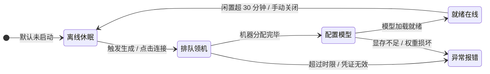

# DSH 独立生图工作台 V2 产品与交互规格书 (STUDIO_V2_SPEC)

> **目标受众**：负责前端重构、文案精简与逻辑编写的代码开发 Agent。  
> **核心使命**：彻底剔除界面中堆砌的“AI自嗨感”与生造概念；将伪聊天重塑为真正的创作助手；用启发式灵感解决“用户不知如何描述”的痛点；将冗长说明收敛进悬浮提示（Tooltip）；建立清晰、平实、透明的人机交互标准。

---

## 1. 术语与概念重定义（去 AI 味标准）

严禁在 UI 界面与交互文案中使用内部代号或生硬借喻。全站术语强制规范如下：

| 模块 / 概念 | 废弃旧词（AI味 / 过于花哨） | 标准新词（平实、专业、直接） | 说明与适用场景 |
| :--- | :--- | :--- | :--- |
| **主画面预览** | 焦舞台 (`Focus Stage`) | **画面预览** (`Preview Stage`) | 用户审视大图的视觉主区域 |
| **最近生成栏** | 胶卷 / 胶卷坞 (`Filmstrip`) | **最近生成** (`Recent`) | 底部或下侧展示最近批次的缩略图栏 |
| **顶部视图标签** | 工坊 (`Studio`) | **创作** (`Generate`) | 顶栏与画廊平级的创作标签 |
| **历史产物视图** | 资产画廊 (`Asset Gallery`) | **作品画廊** (`Gallery`) | 集中管理本地所有生成产物的视图 |
| **随机数生成** | 换种子抽卡 (`Reroll`) | **生成变体** (`New Variant`) | 换随机 seed 生成新图，弃用轻浮的“抽卡” |
| **参数复用** | 以此图微调 (`Iterate`) | **带回参数** (`Recall`) | 将历史图片的完整参数回填到左侧表单 |
| **风格预设** | 风格胶囊 (`Capsule`) | **风格预设** (`Style`) | 预置的画风标签 |
| **算力状态** | 算力胶囊 (`Compute Pill`) | **GPU 状态** (`GPU Status`) | 顶栏云端机器状态指示条 |
| **额度展示** | 免费额度 (`Free Quota`) | **Kaggle 剩余算力** (`Kaggle Quota`) | 明确指出算力来源与属性 |

---

## 2. 界面结构与空间布局规范 (Layout & Structural Hierarchy)

### 2.1 彻底废弃伪 IDE 双重侧栏（干掉 RailNav）
- **核心纠偏**：原版本中 `极窄图标条 (RailNav) + 宽创作面板 (Rail)` 的双层侧栏存在严重的功能冗余与空间浪费。
- **重构架构**：
  1. **彻底移除极窄图标栏 (`RailNav`)**；
  2. 视图导航（`创作` / `画廊`）与状态展示全部统一收归**顶栏 (`TopBar`)**，不在左侧重复造轮子；
  3. 左侧仅保留**固定宽度的单轨创作面板 (320px~340px)**，无需多余的展开/折叠控件（需要全宽沉浸浏览时切到「画廊」视图或点击图片放大即可），结构保持恒定、清晰、零认知负担。

```
┌────────────────────────────────────────────────────────────────────────────────────────┐
│ [顶栏 TopBar] 开源生图 (Free Imagen)   [创作 | 画廊]        GPU在线 · 6s  [SDXL 预设 v]│
├──────────────────────────────┬─────────────────────────────────────────────────────────┤
│ 单轨创作面板 (320px 恒定)    │ 画面预览区 (Preview Stage，自适应占据全部剩余空间)       │
│ ┌──────────────────────────┐ │                                                         │
│ │ 提示词 (Prompt)          │ │                                                         │
│ │ [✦智能润色] [💡灵感预设]  │ │                                                         │
│ ├──────────────────────────┤ │                                                         │
│ │ 风格与画幅 (1:1/16:9)    │ │                                                         │
│ ├──────────────────────────┤ │                                                         │
│ │ 高级参数 (折叠抽屉)      │ │                                                         │
│ ├──────────────────────────┤ │ ┌─────────────────────────────────────────────────────┐ │
│ │ [立即生成 Ctrl+Enter]    │ │ │ 最近生成：[缩略图1] [缩略图2] [缩略图3] ...         │ │
│ └──────────────────────────┘ │ └─────────────────────────────────────────────────────┘ │
└──────────────────────────────┴─────────────────────────────────────────────────────────┘
```

---

## 3. 界面减负与悬浮提示规范 (Tooltip System)

### 2.1 界面排版第一原则：主干极简，细节悬浮
- **标题与字段名**：严禁超过 4 个汉字（如：`提示词`、`排除项`、`画面尺寸`、`采样步数`）。
- **说明文案**：主界面不放置超过 1 行的解释性文字；凡属**“运作原理”、“生效约束”、“规则警示”**，一律隐藏在字段旁的 `(ℹ)` 或 `(!)` 悬浮图标内，鼠标 hover 时显示 Tooltip。

### 2.2 悬浮提示 (Tooltip) 部署明细

| 字段 / 区域 | 界面直接展示的标签 | 悬浮图标 | 悬浮提示完整内容 (Tooltip Content) |
| :--- | :--- | :---: | :--- |
| **排除项** | 排除项 | `(ℹ)` | “画面中不希望出现的元素。注意：仅在引导强度 (CFG) > 0 时生效。” |
| **采样步数** | 采样步数 | `(ℹ)` | “模型迭代去噪的步数。SDXL Lightning 推荐 4~8 步，SDXL Base 推荐 25~30 步。” |
| **引导强度** | 引导强度 (CFG) | `(ℹ)` | “数值越高越贴合提示词，过高可能产生色彩失真。默认推荐 1.5~7.0。” |
| **Kaggle 账号** | Kaggle 状态 | `(!)` | “Kaggle 账号必须完成手机号绑定。未绑定的账号会被平台静默降级为 CPU，无法出图。” |
| **空闲休眠** | 在线 · 单张约 6s | `(ℹ)` | “云端实例空闲超过 30 分钟将自动关机，以节省你的每周 30 小时免费 GPU 额度。” |
| **提示词输入** | 提示词 | `(ℹ)` | “支持中英文输入。英文提示词在多数开源模型上细节表现更丰富。” |

---

## 3. 启发式灵感与分层润色体系 (Inspiration & Refinement)

解决核心痛点：**“用户想画图，但面对空白输入框无从下手，或者不知道当前模型适合什么词”**。

```
┌─────────────────────────────────────────────────────────────┐
│ 提示词                                                      │
│ ┌─────────────────────────────────────────────────────────┐ │
│ │ 赛博朋克风格的雨夜街景                                   │ │
│ └─────────────────────────────────────────────────────────┘ │
│ [✦ 智能润色] [💡 灵感预设]                                  │
│                                                             │
│ 💡 启发式灵感示例（点击填入）：                             │
│ [棚拍人像] [科幻街景] [水墨意境] [3D黏土] [微距自然]        │
│                                                             │
│ ✦ 润色维度推荐（点击追加）：                                │
│ + [光影] 湿润地面霓虹倒影   + [镜头] 35mm 广角景深          │
│ + [细节] 细腻雨丝与雾气     + [色调] 蓝紫冷暖对冲          │
└─────────────────────────────────────────────────────────────┘
```

### 3.1 预置启发式灵感库 (Inspiration Presets)
在提示词输入框为空或用户点击“灵感”时，展示 5~6 个代表性的启发式场景卡（点击直接作为 Prompt 填入）：
1. **科幻赛博**：`雨夜的未来城市街景，湿润地面倒映霓虹招牌，充满雾气与层次感`
2. **人像摄影**：`室内柔和自然光人像，35mm 胶片质感，细腻发丝与浅景深`
3. **东方意境**：`传统水墨风格的远山苍茫，云雾缭绕中的孤舟与古松，大面积留白`
4. **3D 萌系**：`可爱的毛绒质感小动物，柔和暖色棚拍光，C4D 风格高细节粘土模型`
5. **微距自然**：`晨光下的晶莹露珠与叶片叶脉，极细腻微距摄影，梦幻光斑光晕`

### 3.2 模块化分层润色 (Modular Refinement Chips)
当用户输入了简短的一两句话（如“雨夜街景”）并点击 **[✦ 智能润色]** 时：
- **禁止行为**：不要直接覆盖用户的输入框，也不要只吐出 3 句孤零零的完整英文长句。
- **规范行为**：解析并提供 4 个可独立点选追加的**维度标签**（点击即可追加到当前输入框末尾）：
  - `[光影]`：如 `柔和漫射光`、`强烈戏剧性侧光`、`霓虹冷暖反光`
  - `[材质]`：如 `金属拉丝高光`、`湿润粗糙沥青地面`、`磨砂半透明质感`
  - `[构图]`：如 `对称中心构图`、`低角度仰拍纵深`、`浅景深电影画幅`
  - `[氛围]`：如 `静谧雾气`、`粒子尘埃漂浮`、`赛博朋克冷峻基调`
- **模型自适应**：
  - 若为 **SDXL Lightning**：推荐词偏向“明确结构主体 + 光影主基调”，避免冗长修辞堆砌；
  - 若为 **SDXL Base**：补充更丰富的细节修饰与质感描写。

---

## 4. 表单与对话两大入口规范

### 4.1 表单模式 (Form Mode)：高效、精准
- 适用场景：明确知道参数需求、需要批量出图、微调步数和 CFG 的创作者。
- 布局动线：
  1. 提示词输入框 + 启发式灵感 / 润色工具条；
  2. 画面比例（1:1、16:9、9:16、4:3、3:4）以直观图形块展示；
  3. 常用风格预设（写实摄影、动漫插画、赛博朋克、水墨写意等）；
  4. 高级参数折叠抽屉（采样步数、CFG、随机种子、批量张数），默认收起；
  5. 底部固底的大号 `[立即生成 (Ctrl+Enter)]` 按钮。

### 4.2 对话模式 (Chat Mode)：意图解析助手（非打字机）
- 适用场景：用户只有模糊想法，希望自然对话出图。
- 交互机制转变：
  - **用户输入**：“给我画一张横版的雨夜街景，要写实一点，画质高一些”
  - **助手反馈**：
    1. 意图解析：提取提示词并完成初次润色，自动选定 `16:9` 比例与 `写实摄影` 风格；
    2. 生成确认气泡：气泡内呈现一个优雅的预览卡片（显示提取出的提示词、模型、尺寸与生成按钮）；
    3. 支持自然语言迭代：“背景加一只撑伞的黑猫” → 助手自动继承前次 seed 和参数，仅增量更新画面描述并出图。

---

## 5. 云端 GPU 状态透明化（四阶直觉状态机）

将后端的复杂生命周期折叠为用户完全可理解的四级状态，**拒绝微服务运维黑话，交代清晰的时间预期**：



### 5.1 状态映射与展示标准

| 内部 Phase | 前端展示状态 | 颜色状态 | 界面主文案 | 悬浮或次要提示 |
| :--- | :--- | :---: | :--- | :--- |
| `absent` | **离线 / 休眠** | 灰点 | `云端已休眠` | “首次生成将自动唤醒云端机器” |
| `push` / `queue` | **排队分配** | 琥珀呼吸点 | `正在申请 GPU (排队通常 3~8 分钟)` | 展示已等待秒数，允许用户先设置参数 |
| `connecting` / `warming` | **准备模型** | 琥珀呼吸点 | `云端显卡就绪，正在装载模型权重` | 进度条推进，提示“即将完成，开机后单张 6s” |
| `ready` (在线) | **就绪在线** | 绿点 | `云端在线 · 单张约 6 秒` | “当前空闲；闲置 30 分钟将自动关机保额度” |
| `stopping` | **关机释放** | 灰点 | `正在释放云端实例…` | “正在安全关机以节省 Kaggle 额度” |
| `error` | **连接异常** | 红点 | `连接未完成` | 提供带明确动作的修复卡片（重试/检查配置） |

---

## 6. 作品画廊（创作管理规范）

画廊的核心不是做普通文件相册，而是围绕 **“创作回溯与本地交付”**：
1. **带回参数 (Recall)**：
   - 鼠标悬浮在任意作品缩略图上，核心操作是：`[带回参数]`、`[生成变体]`、`[查看大图]`。
   - 点击 `带回参数` 立即切换到创作页，并将原图的 Prompt、Negative、模型预设、尺寸、步数、CFG 完整回填。
2. **变体归拢 (Variants)**：
   - 基于同一套参数换 seed 生成的图片，在画廊中打上批次标签或微型角标，支持快捷横向对比。
3. **本地磁盘可见性**：
   - 顶栏常驻 `[在文件夹中打开]` 按钮，一键调起操作系统资源管理器定位到 `imagen-output/`。
   - 单图支持一键 `[复制文件绝对路径]`，方便用户在 DSH Desktop 或本地其他工程中直接使用。

---

## 7. 国际化文案字典全量替换规格 (`zh.js`)

代码开发 Agent 请按以下键值直接替换 `src/dict/zh.js` 与 `en.js`：

```javascript
// src/dict/zh.js 替换与增补规格
export const zh = {
  // 顶栏与品牌
  'studio.nav.label': '开源生图',
  'studio.brand': '开源生图',
  'studio.brandSub': 'Studio',
  'studio.tab.studio': '创作',
  'studio.tab.gallery': '画廊',

  // 算力与状态
  'studio.compute.offline': '离线休眠',
  'studio.compute.queued': '正在申请 GPU（通常需 3~8 分钟）',
  'studio.compute.warming': '机器已分配，正在装载模型',
  'studio.compute.online': '云端在线 · 单张约 6 秒',
  'studio.compute.stopping': '正在释放云端实例…',
  'studio.compute.error': '连接异常',
  'studio.compute.quota': 'Kaggle 剩余算力',
  'studio.compute.idleTooltip': '云端实例闲置 30 分钟将自动关机，以节省你的每周 30 小时免费 GPU 额度。',
  'studio.compute.authTooltip': 'Kaggle 账号必须完成手机号绑定，未绑定的账号无法调用 GPU。',

  // 创作面板
  'studio.rail.title': '生成设置',
  'studio.rail.modeForm': '参数表单',
  'studio.rail.modeChat': '创作助手',
  'studio.prompt': '提示词',
  'studio.promptPlaceholder': '输入画面描述（支持中英文，Ctrl+Enter 快捷生成）',
  'studio.promptTooltip': '支持中英文描述；建议包含主体、光影、构图与画风。',
  'studio.negative': '排除项',
  'studio.negativePlaceholder': '画面中不希望出现的元素（如模糊、文字）',
  'studio.negativeTooltip': '排除项仅在引导强度 (CFG) > 0 时生效。',

  // 启发式灵感与润色
  'studio.inspire.title': '灵感示例',
  'studio.enhance.button': '智能润色',
  'studio.enhance.thinking': '正在分析构图建议…',
  'studio.refine.lighting': '光影材质',
  'studio.refine.composition': '构图视角',
  'studio.refine.atmosphere': '画面氛围',

  // 参数表单
  'studio.preset': '模型预设',
  'studio.style': '风格预设',
  'studio.ratio': '画面比例',
  'studio.advanced': '高级参数',
  'studio.steps': '采样步数',
  'studio.stepsTooltip': '模型去噪步数。Lightning 预设推荐 4~8 步，经典 Base 推荐 25~30 步。',
  'studio.cfg': '引导强度',
  'studio.cfgTooltip': '数值越高越紧贴提示词。过高可能产生色彩过饱和，推荐 1.5~7.0。',
  'studio.seed': '随机种子',
  'studio.count': '生成张数',
  'studio.generate': '立即生成',
  'studio.generating': '提交任务中…',

  // 预览大图
  'studio.stage.empty': '画面预览',
  'studio.stage.emptyHint': '在左侧输入画面描述，点击生成即可开始出图。',
  'studio.action.recall': '带回参数',
  'studio.action.variant': '生成变体',
  'studio.action.copyPath': '复制文件路径',
  'studio.action.openFolder': '在文件夹中打开',
  'studio.recent.title': '最近生成',

  // 画廊
  'studio.gallery.title': '作品画廊',
  'studio.gallery.empty': '暂无历史作品，前往创作页生成第一张图。',
  'studio.gallery.search': '搜索提示词或模型…',
  'studio.toast.recalled': '参数已恢复到表单',
  'studio.toast.copied': '已复制文件绝对路径',
}
```

---

## 8. 代码重构落地清单 (Agent Implementation Checklist)

1. **[移除冗余侧栏]** 废除 `src/studio/RailNav.jsx`，从 `Studio.jsx` 中移除图标栏组件，将创作面板改造为恒定宽度的单轨面板（320px），无需折叠状态，保持结构极简稳定。
2. **[文案替换]** 更新 `src/dict/zh.js` 与 `src/dict/en.js`，严格按照第 1、8 节完成所有 Key 值的替换与新增。
3. **[Tooltip 组件]** 在 `src/components/` 或 `src/studio/` 下封装轻量 `<Tooltip text="...">` 悬浮组件，为排除项、CFG、步数、Kaggle 状态加上 `(ℹ)` / `(!)`。
4. **[灵感与润色]**
   - 在 `src/studio/Rail.jsx` 增加启发式灵感预设标签；
   - 改造 `lib/enhance.js` 与前端交互，将润色建议改为结构化的可点选维度（光影、构图、材质）。
5. **[ChatPanel 重塑]**
   - 移除单纯的任务进度汇报，引入简单的意图解析卡片（提示词提炼 + 尺寸识别 + 生成按钮）。
6. **[画廊与操作]**
   - 将“以此图微调”改为“带回参数 (`Recall`)”，将“换种子抽卡”改为“生成变体 (`New Variant`)”；
   - 增加“在文件夹中打开”快捷动作。
7. **[测试回归]** 运行 `npm test` 与 `node test/check-client-locale.mjs`，确保所有键完整对齐、单测全部通过。
